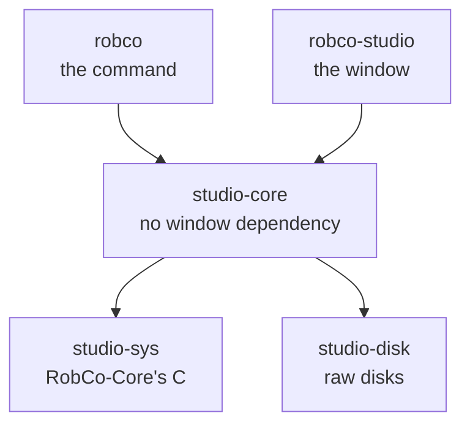

# Architecture

Studio is a core library with a command line, and a window that calls the same library. The core has no window dependency. Every feature lands in the core with a command and a test before the window shows it.

Today every crate is a shell. This page shows where code will go.

## Crates

The build arrows go one way: the two low libraries, then the core, then the two programs.

### studio-sys

A library that compiles a fixed list of RobCo-Core's C files from the submodule at `external/robco-core` and exposes them through hand-written declarations and safe wrappers: image checks, CRC-32, INI and FAT card images through FatFs. Image sealing comes later. See [crates/studio-sys/README.md](../crates/studio-sys/README.md). It depends on no other crate of the workspace. `unsafe` is allowed here, because calling C needs it.

### studio-disk

A library that will list disks and read and write raw blocks on each system, refuse a system disk, and run as an elevated helper. It is empty today. It depends on no other crate of the workspace. `unsafe` is allowed here, because raw disk access calls system interfaces.

### studio-core

The headless product. It will hold projects, SDK install, builds, asset packing, card images, simulator sessions, the serial monitor and debug sessions. Today it holds the version, which comes from `workspace.package.version` in the root `Cargo.toml`, the reader of `robco.toml`, and the build plan, which reads `flags.json` and lists the commands of a build and the folders they write into, without running them. It never depends on a window or toolkit crate. `unsafe` is forbidden.

### robco

The command. It will parse arguments and print JSON events, and leave all work to the core. Today it answers `robco --version` and `robco version`. `unsafe` is forbidden.

### robco-studio

The window. It will draw views and editors through a thin layer of our own over the toolkit, and hold no logic a test cannot reach through the core. Today it prints its version and opens no window. `unsafe` is forbidden.
