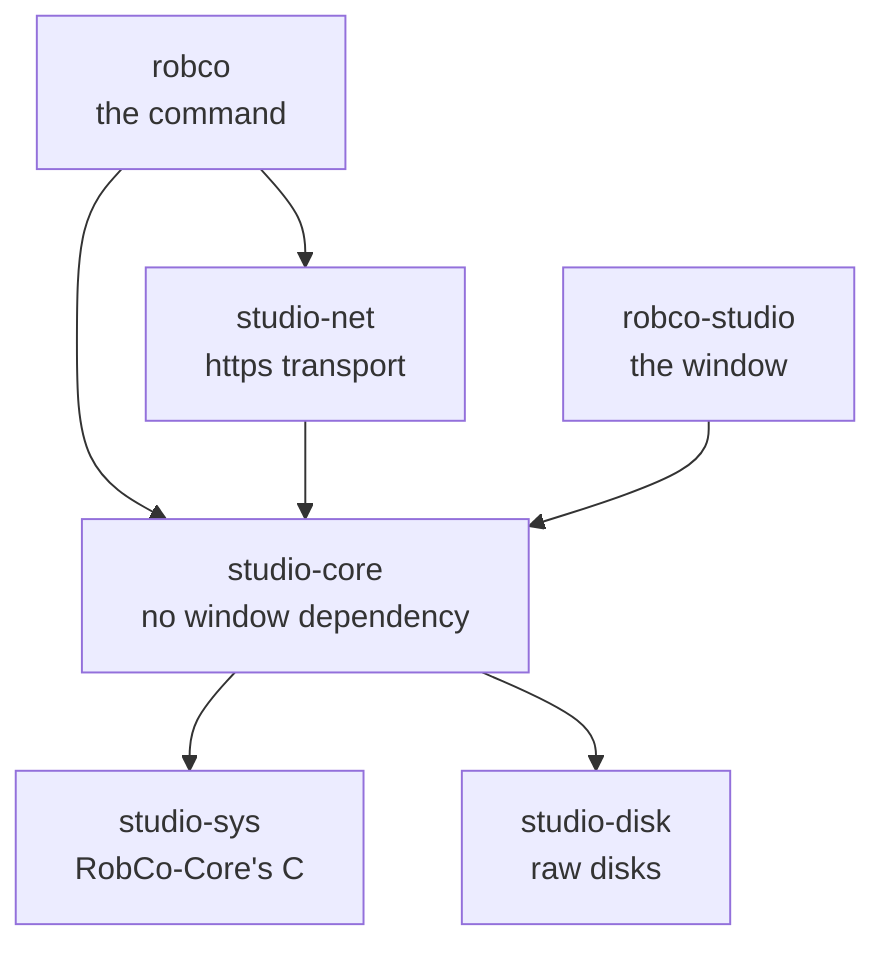
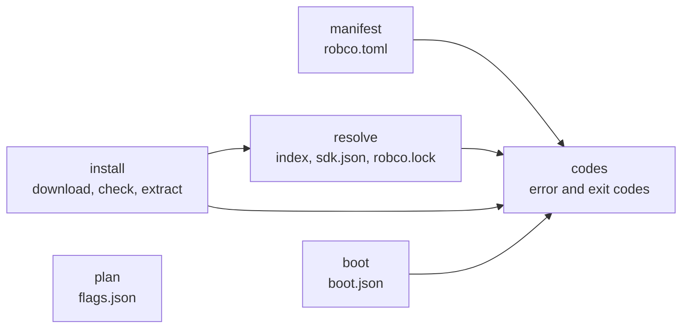
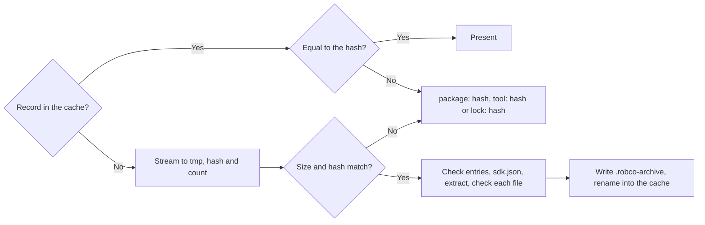
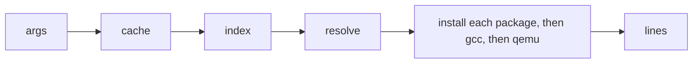
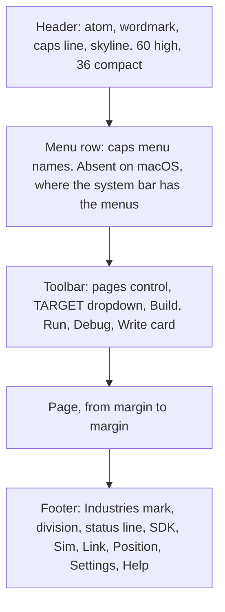

# Architecture

Studio is a core library with a command line, and a window that calls the same library. The core has no window dependency. Every feature lands in the core with a command and a test before the window shows it.

This page shows where the code is and where it will go.

## Crates

The build arrows go one way: the two low libraries, then the core, then the transport, then the two programs.

Inside `studio-core`, the build plan, the lock and the code table stand apart. Every error of `manifest`, `resolve`, `install` and `boot` names a code of `codes`.

### studio-sys

A library that compiles a fixed list of RobCo-Core's C files from the submodule at `external/robco-core` and exposes them through hand-written declarations and safe wrappers: image checks, image sealing and packing, CRC-32, INI and FAT card images through FatFs. Sealing and packing run RobCo-Core's C `rimg_seal` and `rimg_pack`, as [IMAGE_FORMAT.md](https://github.com/RobCo-Industries/RobCo-Core/blob/main/docs/spec/IMAGE_FORMAT.md#sealing-and-packing) defines them; Rust has no second sealer. See [crates/studio-sys/README.md](../crates/studio-sys/README.md). It depends on no other crate of the workspace. `unsafe` is allowed here, because calling C needs it.

### studio-disk

A library that will list disks and read and write raw blocks on each system, refuse a system disk, and run as an elevated helper. It is empty today. It depends on no other crate of the workspace. `unsafe` is allowed here, because raw disk access calls system interfaces.

### studio-core

The headless product. It will hold projects, SDK install, builds, asset packing, card images, simulator sessions, the serial monitor and debug sessions. Today it holds the version, which comes from `workspace.package.version` in the root `Cargo.toml`, the reader of `robco.toml`, and the build plan, which reads `flags.json` and lists the commands of a build and the folders they write into, without running them. It also holds `resolve`, `install` and `codes`, below. It never depends on a window or toolkit crate. `unsafe` is forbidden.

#### resolve

`resolve` picks the SDK packages and tools a project builds with. It reads the SDK index and a package's `sdk.json`, picks package versions by the version and ABI rules, and reads, checks and writes `robco.lock`. It checks a lock for staleness against the target and the host. It follows [SDK_PACKAGE.md](https://github.com/RobCo-Industries/RobCo-Core/blob/main/docs/spec/SDK_PACKAGE.md) and the `robco.lock` section of [STUDIO_PROJECT.md](https://github.com/RobCo-Industries/RobCo-Core/blob/main/docs/spec/STUDIO_PROJECT.md).

It never downloads, installs or starts a process. Only the lock code touches files, in a folder the caller names. No function both resolves and writes the lock: `use_or_resolve` and `resolve_again` return a resolution and write nothing.

A caller must write the lock with `lock::write` only for a `Resolution::New`, and only after every install passed. A command that fails before then writes no lock, so a first build keeps no lock and `robco update` keeps the old one. The write goes through a temporary file renamed over the old lock, so a failure never leaves half a lock.

#### install

`install` puts packages and tools into the cache, by "The archive", "What the cache records", "Tool archives" and "Hashes" of [SDK_PACKAGE.md](https://github.com/RobCo-Industries/RobCo-Core/blob/main/docs/spec/SDK_PACKAGE.md). A command calls `install::package` and `install::tool` between resolving and `lock::write`, and writes the lock only when every call passed.

`install::package_watched` and `install::tool_watched` take a `Progress` too, and tell it each step of "step" in [STUDIO_CLI.md](https://github.com/RobCo-Industries/RobCo-Core/blob/main/docs/spec/STUDIO_CLI.md) as it begins and ends. `package` and `tool` pass `Quiet`, which ignores them.

| Phase | Covers | Fails here |
|---|---|---|
| `Download` | The fetch | A transport that fails, more bytes than the index says, a write to the cache |
| `Verify` | Size and SHA-256 of the archive | A short download, a wrong hash |
| `Install` | The archive rules, `sdk.json`, the `pipos` layout, the extraction, each file's hash, the record and the rename | `package: archive`, `package: manifest`, a file whose hash differs, `tool: archive`, a failed rename |

The calls come in the order `start`, `done` per phase. A failure leaves its phase started and not done. An item the cache holds with the expected record gets one `skip`. A record that differs gets no call.

The caller passes a `Transport` that fetches the bytes of a `url`. `LocalFiles` reads a local index's relative paths and fetches nothing from `https://`. No `https` transport exists yet.

How it keeps the cache whole:

- A download streams into a temporary file under `<cache>/tmp/` while it is hashed and counted. It is renamed to the archive only on a match. A download that stops short or cannot be fetched is a mismatch. Nothing is retried from another place.
- A package archive is checked whole before anything is extracted: names, case, entry kinds, compression, `sdk.json` and its index entry, unlisted files, and for `pipos` every file of "Layout of pipos". Each extracted file is then checked against its size and hash.
- A tool archive is extracted with no write through a link. Each link must resolve inside the extraction folder. A link that resolves to nothing is refused.
- `.robco-archive` is written last in the temporary folder, and one rename moves the folder into the cache. A cache folder without a valid record is moved aside and removed by the next install.
- When two installs of one item race, the second rename fails, and that install compares the first one's record.
- A failure removes the temporary folder. A folder in the cache is never written after its rename.

#### codes

`codes` holds the table of error codes and the exit code of each, from the "Exit codes" and "Error codes" sections of [STUDIO_CLI.md](https://github.com/RobCo-Industries/RobCo-Core/blob/main/docs/spec/STUDIO_CLI.md). Every error of `manifest`, `resolve`, `install` and `boot` gives its code through the `ErrorCode` trait, and `exit_code` maps a code to the number the command ends with. It reads no file and prints nothing.

### studio-net

The `https` transport. It implements `studio-core`'s `Transport` trait, so the installer still counts, hashes and bounds every byte and decides every error code. It is a crate of its own so that the TLS stack stays out of `studio-core`, and out of any program that downloads nothing. It is a small HTTP/1.1 client over `rustls`, so each rule below is in one file, `crates/studio-net/src/lib.rs`:

- Only `https://`, also after a redirect. At most 5 redirects, to any host, since release files on GitHub are served from another host. A `Location` that is not `https://`, `//host/...` or `/path` is refused.
- A URL is parsed by hand, by RFC 3986 and RFC 9110, and strictly: nothing is repaired, a URL is taken as given or refused. The `url` crate was not used: it repairs what this client must refuse, such as a backslash or a short IPv4 form, and it adds the Unicode tables of IDNA. Refused: a scheme other than `https` in any case; any `@` in the authority; a byte that is not printable ASCII anywhere; a host name of other than letters, digits, `-` and `.`, with an empty label, a trailing dot, a label over 63 bytes or more than 253 bytes; a host whose last label does not start with a letter and that is not a dotted IPv4 address, such as `127.1`; brackets that hold other than a plain IPv6 address, so no zone identifier, or text after them other than `:port`; a port other than 1 to 65535 in plain digits with no leading zero; in the path or query, a byte RFC 3986 does not allow raw, a backslash among them, or a `%` not followed by two hex digits; a path and query over 8000 bytes. The fragment is never sent.
- The request line and `Host` are built from the parsed parts only. `Host` holds the host, in brackets for IPv6, and `:port` unless the port is 443. The certificate is checked against the parsed host: a DNS name, or an IP address for an address host. A `Location` of the form `//host/path` keeps the scheme, and `/path` keeps the host and port; the result passes the same parser.
- Certificates are checked by `rustls-platform-verifier`, which asks the system's verifier and trust store. No list of roots is bundled, and no switch turns the check off.
- 30 s to connect to one address and 60 s for a read or a write that moves no byte. No retry: a failed fetch is a failure, by "Hashes" of [SDK_PACKAGE.md](https://github.com/RobCo-Industries/RobCo-Core/blob/main/docs/spec/SDK_PACKAGE.md#hashes).
- The body streams into the caller's writer. When the writer refuses, the transfer ends and the connection closes. Nothing holds an archive in memory. An index is held, up to 8 MiB.
- A request carries exactly `Host`, `User-Agent: robco/<version>`, `Accept-Encoding: identity` and `Connection: close`. No cookie and no token. `HTTPS_PROXY` and the other proxy variables are not read.
- An error names a URL without its query, its fragment and any user info, and never prints a header. A URL that is refused is named by its scheme and, once it passed its checks, its host only.
- Only a `200` answer has a body. Up to 4 informational `1xx` answers, such as `103 Early Hints`, are read past. A `101` is an error, since the client asked for no upgrade. `301`, `302`, `303`, `307` and `308` are followed. Every other status fails.
- The response is read strictly, since the caller knows each archive's size and hash and an odd answer is better refused than guessed at. Refused: a version other than HTTP/1.1 and HTTP/1.0; a status of other than three digits; a bare LF, a folded line or a control character in the header block; a header block over 64 KiB or 64 fields; a second `Content-Length`, `Transfer-Encoding`, `Content-Encoding` or `Location`; `Transfer-Encoding` with `Content-Length`, or in an HTTP/1.0 answer; a coding other than `chunked` or `identity`; a `Content-Length` that is not plain digits; a chunk size that is not hex or overflows; more than 64 trailer fields; bytes already read past the end of a framed body; an empty `Location`.
- With no length, the body ends with the connection. Only TLS `close_notify` ends it cleanly: a close without it is an error, so a cut body never passes as a whole one.

The `test-trust` feature adds a constructor that trusts one certificate, and a TLS server on 127.0.0.1 for tests. Only dev-dependencies turn it on, so no program build has it.

`ring` compiles C on every system through the `cc` crate, with the compiler `cc` finds: MSVC on Windows, as for any crate but `studio-sys`. On Linux and macOS it also assembles `.S` files with that compiler. On Windows x64 it links assembly objects that ship with the crate, so no assembler is needed.

### robco

The command. `main.rs` calls the library's `run`, which the program's tests also call with a transport that trusts a test certificate. It reads the command line, writes the two output streams and leaves all work to the core. It answers `robco --version`, `robco version`, `robco build`, `robco sdk list` and `robco sdk install`, by [STUDIO_CLI.md](https://github.com/RobCo-Industries/RobCo-Core/blob/main/docs/spec/STUDIO_CLI.md). `unsafe` is forbidden.

Each part is a module of its own:

- `args` reads the command line by hand. Every wrong form gives `usage`.
- `cache` finds the cache folder, with `ROBCO_CACHE` first.
- `index` sorts a `--index` location and reads the index, from a local file or from an `https://` URL through `studio-net`. A download that fails, or an index longer than 8 MiB, gives `index: read`.
- `net` starts TLS on the first download only, and sends each archive `url` to `studio-net` or, for a relative path in a local index, to the index folder.
- `list`, `install` and `build` are the three commands.
- `lines` writes JSON lines with `--json`, and text and the one error line without it.

`robco build` takes steps 1 to 11 of "The steps of update, build, run and test" in order. It deletes an older tape right after the manifest, so a later failure leaves none. With a lock and a full cache it reads no index. It writes the lock only after a resolution and once every install passed. It runs each compiler command with no shell and turns each line the program prints into a `diagnostic` line. It seals and validates with `studio-sys`, then checks that the startup code wrote the `abi_version` and `subtype` that `robco.toml` asks for.

`robco sdk install` passes a `Progress` that writes one `step` line per transition, so each line is written when its step begins or ends. A failure leaves its step open, and the error line follows. An item the cache already holds is never fetched and writes one `install` line with `skip`.

### robco-studio

The window, on `eframe` and `egui` 0.37.0. It depends on `studio-core`, and nothing depends on it. `unsafe` is forbidden. It opens no network connection, starts no process and writes no file except one a person saves in the editor.

| Module | Holds |
|---|---|
| `theme` | Every colour, size, stroke, radius and font: the four schemes, high legibility, effects Off and Soft. The only module that may hold a colour or a size literal. |
| `kit` | The thin layer: pane, filled and outlined buttons, tabs, segmented control, zoom group, tree row, text field, dropdown, menu row, banner, empty state, divider, footer segment. The segmented control also serves as a tab list. A view builds from these and never styles the toolkit. Each gives the accessibility tree a role and a name. |
| `art` | The drawings and the icons, rasterised from their SVG files with `resvg`, the Spleen 8x16 label atlas built from its BDF file, its blurred halo atlas, and the application icon. |
| `menus` | The menus, described once. The row in the window and the macOS menu bar both read it. |
| `native_menu` | macOS only: the system menu bar, through `muda`. |
| `chooser` | The folder chooser behind File, Open folder: a small trait, the system dialog through `rfd`, and a fake in the tests. |
| `project` | The open folder, its `robco.toml` read by `studio-core`, and the rows of the Files tree. |
| `document` | One open file: bytes to text and back, LF in the editor, CRLF kept on save. |
| `editor` | Tabs, the text widget per document, the gutter, colours for C, find and replace, and the one question about unsaved edits. |
| `c_lex` | A token pass over C for its colours. |
| `app` | The window: its strips, pages, the panes of the Project page, focus with F6, the dialog. |

The window is cut into strips, top to bottom:

- The header is tall when the window's inner height is 720 points or more, and compact under that or when View, Compact header is on. It takes no focus; a screen reader gets one image named "RobCo Studio".
- Panes are rounded, with a title row and a rule. Tabs stand on the rule; the active tab, the chosen part of a segmented control and the current page are filled in `bright` with a halo.
- The simulator pane shows the device at 62 percent with the empty state in its screen opening while no machine runs, then the honest line and Stop, Reset, Fit and the zoom group. The Simulator menu's scale items set the same step. A step that does not fit the pane is not available, in the pane's Larger button, in the window's menu and in the macOS menu bar alike, with the same reason; one function answers for all three. The room comes from the page layout of each frame, whichever page shows, so a resize on the Card, Device or SDK page updates the menus too. When a resize leaves no room for the chosen step, it drops at once to the largest step that fits, and the status line says so once.
- The pages control is the toolbar's first control: PROJECT, CARD, DEVICE and SDK in one outline. A screen reader gets a tab list named "Pages" with one tab per page, the current one selected. It is one stop in the Tab order, and the left and right arrows move between pages. The page shortcuts and the View menu move its selection.
- The toolbar holds no project control. A divider stands after the pages control and another before the four actions, which share one width. At 1280 points the whole toolbar fits with room to spare.
- The open project is the current document. The window title gives its name, then the application's, as in "PIPES - RobCo Studio", and only "RobCo Studio" with no project. File, Open folder, Cmd or Ctrl+O, opens another one through the system's folder dialog. The dialog starts in the parent of the open project, or the home folder with no project. A project's folder is made absolute when it opens, through links, so a project opened as `.` or `my-project` has its folder's name and a parent for the dialog. A chosen folder goes through the same path as one given on the command line, with the same messages. Documents with edits are asked about first, one by one, with the question quitting asks; Cancel keeps the project and its edits. Cancel in the dialog changes nothing. While the dialog is open nothing in the window acts: the window draws its whole interface disabled, under the scrim its own dialogs use, and the status line says a folder dialog is open. On Linux, where the window keeps drawing, the window can still be moved and repainted, but closing it is refused until the dialog answers. The Files tree has the project as its root row, open at first; closing it hides the tree. A folder without a valid `robco.toml` goes by its folder's name.
- The bottom pane puts the log's filters in its tab row while the Log tab is on.
- A long status line in the footer hides the division first, then Position, then ends in an ellipsis. Settings and Help hold the right end and never give way.

Rules, each with a test:

- No colour, float size or font outside `theme`. `tests/tokens.rs` searches the source.
- Text is never dropped without asking. Closing a tab, quitting or opening another project with edits asks one question per edited document, in turn, each naming its document. The answers are only collected: nothing is saved or dropped until the last one is in. Cancel at any question changes nothing. Once every answer is in, the documents answered Save are saved, one by one. Every save, from Save, Save all or these questions, passes one check right before it writes: the file's bytes against those of the last read or save. A file that changed, was removed or cannot be read stops the run there: nothing after it is saved or dropped, the window stays open with every edit, and Studio asks Overwrite for that file. Overwrite goes on with the rest and finishes the close, quit or switch; Cancel keeps everything. Files saved before the stop stay saved, and the status line says how many and which file stopped the run. A save that fails stops the run the same way.
- A control that cannot act is marked disabled in the accessibility tree and says why.
- F6 moves through the toolbar, the page's panes left to right and top to bottom, then the footer.

Known limits:

- Save writes a temporary file and renames it over the file. The old file stays whole if a save fails, and the permission bits are kept. The saved file is a new file, so it does not keep extended attributes, access control lists, an owner or group that differ from the person saving, or hard links to the old file.
- Studio tells open files apart by their canonical path, taken at open. A file that does not exist yet stands for its folder's canonical path and its name. On macOS the canonical path carries the stored spelling, so two spellings of one name open one tab; this was checked on macOS only.
- Save writes only a document with edits. Before it writes, it compares the file's bytes with those of the last read or save, and asks before it overwrites a file that changed, was removed or cannot be read. Another program can still write between that check and the rename. Answering Save to the close or quit question refuses a file already changed; Cancel, then Save, to choose. A file that changes between the Save answer and the last answer of a close, quit or switch is asked about again, with Overwrite, before it is written. Studio does not watch files and does not reload them.
- There is no Save as yet, and no next tab or previous tab command.
- Save refuses a read-only file.
- Tabs that do not fit scroll sideways and a menu at their end lists them all. A tab out of view is reached by the wheel, the menu or a click in Files; the keyboard cannot scroll the strip.
- Each frame lays out and searches the whole text. A file near 16 MiB, or one very long line, makes the window slow.
- On macOS and Windows the folder dialog runs on the main thread at the top of a frame and blocks it; the last frame stays on screen. On Linux it runs on a thread through the desktop portal, with `zenity` as the fallback. When neither answers within 300 ms with nothing, the status bar says no dialog opened. A portal that accepts the call and never answers keeps the window from taking commands until it is closed. The real dialog was only compiled on macOS; it was not opened on any system. The tests use a fake.
- The Open folder button of the editor pane's empty state and the Open another folder button of its banner run File, Open folder. There is no Open recent: Studio has no settings file yet.
- Studio opens regular files only, links followed. A folder, a named pipe, a device or a socket is refused, and a named pipe is not waited on. A file or a `robco.toml` larger than 16 MiB is refused before it is read. The crate's docs name no limit, so 16 MiB is a default, not a measured need.

`tests/window.rs` drives the window headless with `egui_kittest`. `tests/render.rs` writes PNG pictures of the window when run by hand; they are not compared in CI. Its `render_the_art_sheet` writes `sheet-green.png`: every drawing, every icon and the label styles on the green ground, with effects on at the left and off at the right.

The drawings live in `crates/robco-studio/assets/art/`. Each carries its SPDX lines and a provenance line. The two wordmarks, the atom and the skyline are traced from a reference picture supplied by the project owner. The application icon is built from the traced atom and letter R, on a tile drawn for Studio. The other drawings are drawn for Studio.

| File | What |
|---|---|
| `wordmark.svg` | "RobCo Studio", for the header. Traced. |
| `wordmark-industries.svg` | "RobCo Industries", for the footer. Traced. |
| `atom.svg` | The atom mark. Traced. |
| `skyline.svg` | The works skyline at the right of the header, standing on the header's rule. Traced. |
| `device-frame.svg` | The wrist device around the simulator's screen, with ids for its keys, dial, slot and lamps |
| `holotape.svg` | The tape |
| `card.svg` | The memory card |
| `app-icon.svg` | The application icon, with a small form for 16 to 32 px. It keeps its own ground and colours. |
| `icons.svg` | The icons, as symbols `i-NAME` |

Every file but the application icon draws in `currentColor` on a ground rectangle of class `asset-ground`, so it can be opened and looked at. One loader removes that rectangle, turns the colour white and rasterises the rest at a whole number of device pixels, and the window tints it. The glow of each drawing is its group of class `halo`, blurred by `resvg`; the loader drops that group when effects are off. A file that keeps room around its box for the glow states the box in its comment, "fills the box 0 0 W H", and the texture reaches out of the box by that room. Caps labels in `bright` on `ground` or `pane` can draw over a second Spleen atlas, blurred once on the CPU, for their glow.

A settings file does not exist yet. It would hold the scheme, high legibility, the effects level, the pane sizes and which panes are shown, the text size, and the recent projects.
