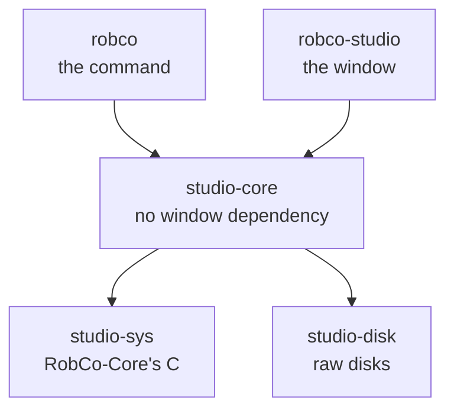
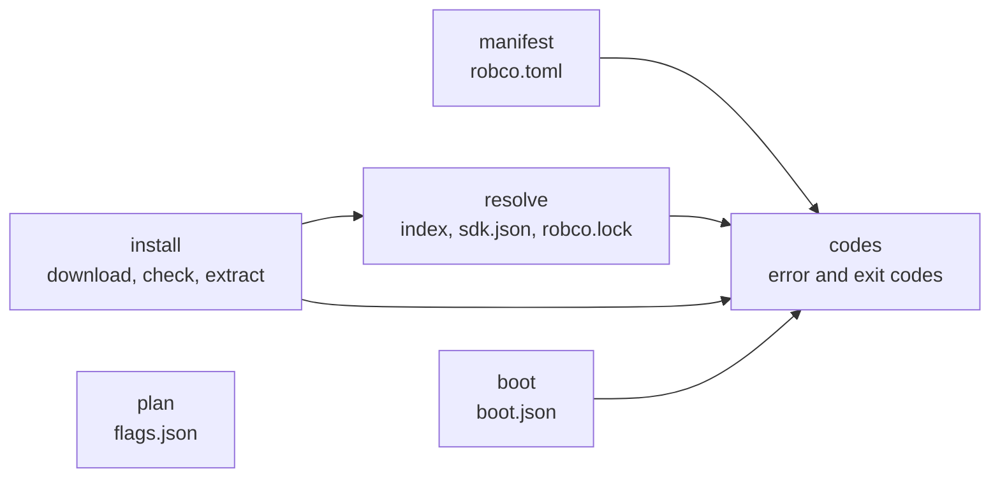
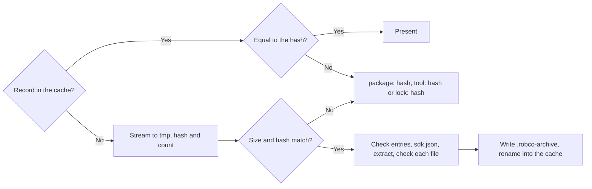
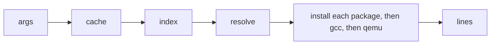

# Architecture

Studio is a core library with a command line, and a window that calls the same library. The core has no window dependency. Every feature lands in the core with a command and a test before the window shows it.

This page shows where the code is and where it will go.

## Crates

The build arrows go one way: the two low libraries, then the core, then the two programs.

Inside `studio-core`, the build plan, the lock and the code table stand apart. Every error of `manifest`, `resolve`, `install` and `boot` names a code of `codes`.

### studio-sys

A library that compiles a fixed list of RobCo-Core's C files from the submodule at `external/robco-core` and exposes them through hand-written declarations and safe wrappers: image checks, image sealing and packing, CRC-32, INI and FAT card images through FatFs. Sealing and packing run RobCo-Core's C `rimg_seal` and `rimg_pack`, as [IMAGE_FORMAT.md](https://github.com/RobCo-Industries/RobCo-Core/blob/main/docs/spec/IMAGE_FORMAT.md#sealing-and-packing) defines them; Rust has no second sealer. See [crates/studio-sys/README.md](../crates/studio-sys/README.md). It depends on no other crate of the workspace. `unsafe` is allowed here, because calling C needs it.

### studio-disk

A library that will list disks and read and write raw blocks on each system, refuse a system disk, and run as an elevated helper. It is empty today. It depends on no other crate of the workspace. `unsafe` is allowed here, because raw disk access calls system interfaces.

### studio-core

The headless product. It will hold projects, SDK install, builds, asset packing, card images, simulator sessions, the serial monitor and debug sessions. Today it holds the version, which comes from `workspace.package.version` in the root `Cargo.toml`, the reader of `robco.toml`, and the build plan, which reads `flags.json` and lists the commands of a build and the folders they write into, without running them. It also holds `resolve`, `install` and `codes`, below. It never depends on a window or toolkit crate. `unsafe` is forbidden.

#### resolve

`resolve` picks the SDK packages and tools a project builds with. It reads the SDK index and a package's `sdk.json`, picks package versions by the version and ABI rules, and reads, checks and writes `robco.lock`. It checks a lock for staleness against the target and the host. It follows [SDK_PACKAGE.md](https://github.com/RobCo-Industries/RobCo-Core/blob/main/docs/spec/SDK_PACKAGE.md) and the `robco.lock` section of [STUDIO_PROJECT.md](https://github.com/RobCo-Industries/RobCo-Core/blob/main/docs/spec/STUDIO_PROJECT.md).

It never downloads, installs or starts a process. Only the lock code touches files, in a folder the caller names. No function both resolves and writes the lock: `use_or_resolve` and `resolve_again` return a resolution and write nothing.

A caller must write the lock with `lock::write` only for a `Resolution::New`, and only after every install passed. A command that fails before then writes no lock, so a first build keeps no lock and `robco update` keeps the old one. The write goes through a temporary file renamed over the old lock, so a failure never leaves half a lock.

#### install

`install` puts packages and tools into the cache, by "The archive", "What the cache records", "Tool archives" and "Hashes" of [SDK_PACKAGE.md](https://github.com/RobCo-Industries/RobCo-Core/blob/main/docs/spec/SDK_PACKAGE.md). A command calls `install::package` and `install::tool` between resolving and `lock::write`, and writes the lock only when every call passed.

`install::package_watched` and `install::tool_watched` take a `Progress` too, and tell it each step of "step" in [STUDIO_CLI.md](https://github.com/RobCo-Industries/RobCo-Core/blob/main/docs/spec/STUDIO_CLI.md) as it begins and ends. `package` and `tool` pass `Quiet`, which ignores them.

| Phase | Covers | Fails here |
|---|---|---|
| `Download` | The fetch | A transport that fails, more bytes than the index says, a write to the cache |
| `Verify` | Size and SHA-256 of the archive | A short download, a wrong hash |
| `Install` | The archive rules, `sdk.json`, the `pipos` layout, the extraction, each file's hash, the record and the rename | `package: archive`, `package: manifest`, a file whose hash differs, `tool: archive`, a failed rename |

The calls come in the order `start`, `done` per phase. A failure leaves its phase started and not done. An item the cache holds with the expected record gets one `skip`. A record that differs gets no call.

The caller passes a `Transport` that fetches the bytes of a `url`. `LocalFiles` reads a local index's relative paths and fetches nothing from `https://`. No `https` transport exists yet.

How it keeps the cache whole:

- A download streams into a temporary file under `<cache>/tmp/` while it is hashed and counted. It is renamed to the archive only on a match. A download that stops short or cannot be fetched is a mismatch. Nothing is retried from another place.
- A package archive is checked whole before anything is extracted: names, case, entry kinds, compression, `sdk.json` and its index entry, unlisted files, and for `pipos` every file of "Layout of pipos". Each extracted file is then checked against its size and hash.
- A tool archive is extracted with no write through a link. Each link must resolve inside the extraction folder. A link that resolves to nothing is refused.
- `.robco-archive` is written last in the temporary folder, and one rename moves the folder into the cache. A cache folder without a valid record is moved aside and removed by the next install.
- When two installs of one item race, the second rename fails, and that install compares the first one's record.
- A failure removes the temporary folder. A folder in the cache is never written after its rename.

#### codes

`codes` holds the table of error codes and the exit code of each, from the "Exit codes" and "Error codes" sections of [STUDIO_CLI.md](https://github.com/RobCo-Industries/RobCo-Core/blob/main/docs/spec/STUDIO_CLI.md). Every error of `manifest`, `resolve`, `install` and `boot` gives its code through the `ErrorCode` trait, and `exit_code` maps a code to the number the command ends with. It reads no file and prints nothing.

### robco

The command. It reads the command line, writes the two output streams and leaves all work to the core. It answers `robco --version`, `robco version`, `robco sdk list` and `robco sdk install`, by [STUDIO_CLI.md](https://github.com/RobCo-Industries/RobCo-Core/blob/main/docs/spec/STUDIO_CLI.md). `unsafe` is forbidden.

Each part is a module of its own:

- `args` reads the command line by hand. Every wrong form gives `usage`.
- `cache` finds the cache folder, with `ROBCO_CACHE` first.
- `index` sorts a `--index` location and reads a local index. An `https://` index fails with `index: read`, since no `https` transport exists yet.
- `list` and `install` are the two commands.
- `lines` writes JSON lines with `--json`, and text and the one error line without it.

`robco sdk install` passes a `Progress` that writes one `step` line per transition, so each line is written when its step begins or ends. A failure leaves its step open, and the error line follows. An item the cache already holds is never fetched and writes one `install` line with `skip`.

### robco-studio

The window. It will draw views and editors through a thin layer of our own over the toolkit, and hold no logic a test cannot reach through the core. Today it prints its version and opens no window. `unsafe` is forbidden.
