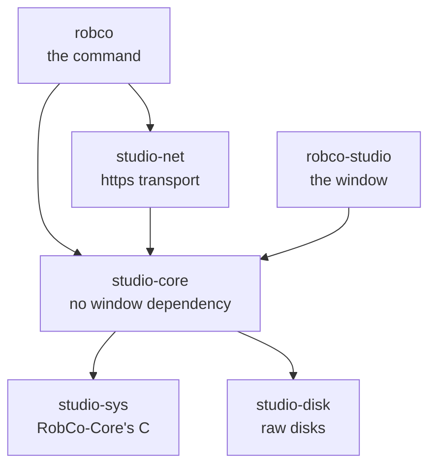
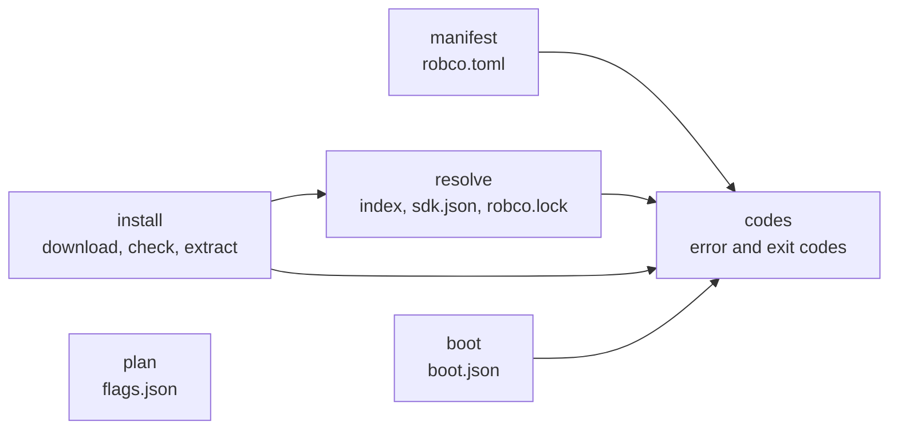
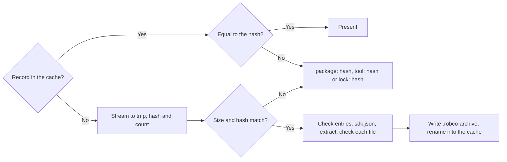
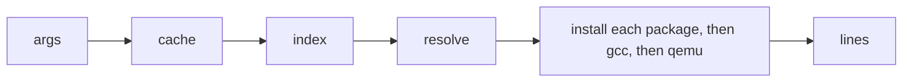
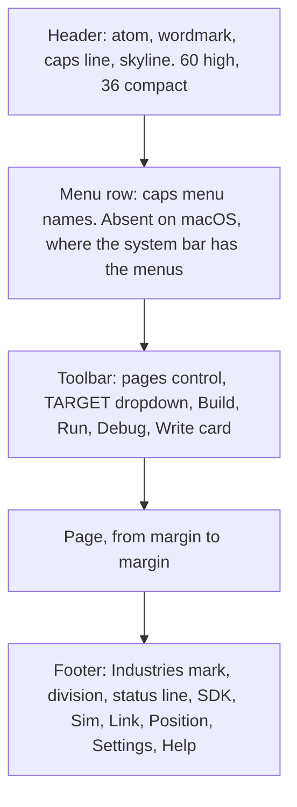
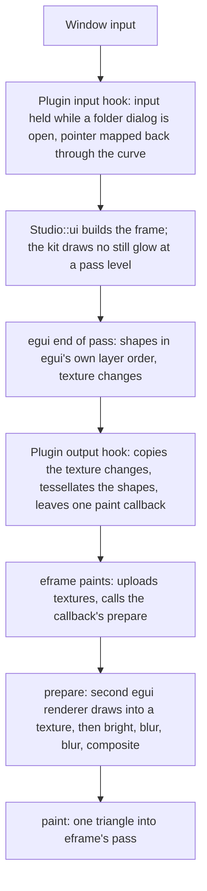

# Architecture

Studio is a core library with a command line, and a window that calls the same library. The core has no window dependency. Every feature lands in the core with a command and a test before the window shows it.

This page shows where the code is and where it will go.

## Crates

The build arrows go one way: the two low libraries, then the core, then the transport, then the two programs.

Inside `studio-core`, the build plan, the lock and the code table stand apart. Every error of `manifest`, `resolve`, `install` and `boot` names a code of `codes`.

### studio-sys

A library that compiles a fixed list of RobCo-Core's C files from the submodule at `external/robco-core` and exposes them through hand-written declarations and safe wrappers: image checks, image sealing and packing, CRC-32, INI and FAT card images through FatFs. Sealing and packing run RobCo-Core's C `rimg_seal` and `rimg_pack`, as [IMAGE_FORMAT.md](https://github.com/RobCo-Industries/RobCo-Core/blob/main/docs/spec/IMAGE_FORMAT.md#sealing-and-packing) defines them; Rust has no second sealer. See [crates/studio-sys/README.md](../crates/studio-sys/README.md). It depends on no other crate of the workspace. `unsafe` is allowed here, because calling C needs it.

### studio-disk

A library that will list disks and read and write raw blocks on each system, refuse a system disk, and run as an elevated helper. It is empty today. It depends on no other crate of the workspace. `unsafe` is allowed here, because raw disk access calls system interfaces.

### studio-core

The headless product. It will hold projects, SDK install, builds, asset packing, card images, simulator sessions, the serial monitor and debug sessions. Today it holds the version, which comes from `workspace.package.version` in the root `Cargo.toml`, the reader of `robco.toml`, and the build plan, which reads `flags.json` and lists the commands of a build and the folders they write into, without running them. It also holds `resolve`, `install` and `codes`, below. It never depends on a window or toolkit crate. `unsafe` is forbidden.

#### resolve

`resolve` picks the SDK packages and tools a project builds with. It reads the SDK index and a package's `sdk.json`, picks package versions by the version and ABI rules, and reads, checks and writes `robco.lock`. It checks a lock for staleness against the target and the host. It follows [SDK_PACKAGE.md](https://github.com/RobCo-Industries/RobCo-Core/blob/main/docs/spec/SDK_PACKAGE.md) and the `robco.lock` section of [STUDIO_PROJECT.md](https://github.com/RobCo-Industries/RobCo-Core/blob/main/docs/spec/STUDIO_PROJECT.md).

It never downloads, installs or starts a process. Only the lock code touches files, in a folder the caller names. No function both resolves and writes the lock: `use_or_resolve` and `resolve_again` return a resolution and write nothing.

A caller must write the lock with `lock::write` only for a `Resolution::New`, and only after every install passed. A command that fails before then writes no lock, so a first build keeps no lock and `robco update` keeps the old one. The write goes through a temporary file renamed over the old lock, so a failure never leaves half a lock.

#### install

`install` puts packages and tools into the cache, by "The archive", "What the cache records", "Tool archives" and "Hashes" of [SDK_PACKAGE.md](https://github.com/RobCo-Industries/RobCo-Core/blob/main/docs/spec/SDK_PACKAGE.md). A command calls `install::package` and `install::tool` between resolving and `lock::write`, and writes the lock only when every call passed.

`install::package_watched` and `install::tool_watched` take a `Progress` too, and tell it each step of "step" in [STUDIO_CLI.md](https://github.com/RobCo-Industries/RobCo-Core/blob/main/docs/spec/STUDIO_CLI.md) as it begins and ends. `package` and `tool` pass `Quiet`, which ignores them.

| Phase | Covers | Fails here |
|---|---|---|
| `Download` | The fetch | A transport that fails, more bytes than the index says, a write to the cache |
| `Verify` | Size and SHA-256 of the archive | A short download, a wrong hash |
| `Install` | The archive rules, `sdk.json`, the `pipos` layout, the extraction, each file's hash, the record and the rename | `package: archive`, `package: manifest`, a file whose hash differs, `tool: archive`, a failed rename |

The calls come in the order `start`, `done` per phase. A failure leaves its phase started and not done. An item the cache holds with the expected record gets one `skip`. A record that differs gets no call.

The caller passes a `Transport` that fetches the bytes of a `url`. `LocalFiles` reads a local index's relative paths and fetches nothing from `https://`. No `https` transport exists yet.

How it keeps the cache whole:

- A download streams into a temporary file under `<cache>/tmp/` while it is hashed and counted. It is renamed to the archive only on a match. A download that stops short or cannot be fetched is a mismatch. Nothing is retried from another place.
- A package archive is checked whole before anything is extracted: names, case, entry kinds, compression, `sdk.json` and its index entry, unlisted files, and for `pipos` every file of "Layout of pipos". Each extracted file is then checked against its size and hash.
- A tool archive is extracted with no write through a link. Each link must resolve inside the extraction folder. A link that resolves to nothing is refused.
- `.robco-archive` is written last in the temporary folder, and one rename moves the folder into the cache. A cache folder without a valid record is moved aside and removed by the next install.
- When two installs of one item race, the second rename fails, and that install compares the first one's record.
- A failure removes the temporary folder. A folder in the cache is never written after its rename.

#### codes

`codes` holds the table of error codes and the exit code of each, from the "Exit codes" and "Error codes" sections of [STUDIO_CLI.md](https://github.com/RobCo-Industries/RobCo-Core/blob/main/docs/spec/STUDIO_CLI.md). Every error of `manifest`, `resolve`, `install` and `boot` gives its code through the `ErrorCode` trait, and `exit_code` maps a code to the number the command ends with. It reads no file and prints nothing.

### studio-net

The `https` transport. It implements `studio-core`'s `Transport` trait, so the installer still counts, hashes and bounds every byte and decides every error code. It is a crate of its own so that the TLS stack stays out of `studio-core`, and out of any program that downloads nothing. It is a small HTTP/1.1 client over `rustls`, so each rule below is in one file, `crates/studio-net/src/lib.rs`:

- Only `https://`, also after a redirect. At most 5 redirects, to any host, since release files on GitHub are served from another host. A `Location` that is not `https://`, `//host/...` or `/path` is refused.
- A URL is parsed by hand, by RFC 3986 and RFC 9110, and strictly: nothing is repaired, a URL is taken as given or refused. The `url` crate was not used: it repairs what this client must refuse, such as a backslash or a short IPv4 form, and it adds the Unicode tables of IDNA. Refused: a scheme other than `https` in any case; any `@` in the authority; a byte that is not printable ASCII anywhere; a host name of other than letters, digits, `-` and `.`, with an empty label, a trailing dot, a label over 63 bytes or more than 253 bytes; a host whose last label does not start with a letter and that is not a dotted IPv4 address, such as `127.1`; brackets that hold other than a plain IPv6 address, so no zone identifier, or text after them other than `:port`; a port other than 1 to 65535 in plain digits with no leading zero; in the path or query, a byte RFC 3986 does not allow raw, a backslash among them, or a `%` not followed by two hex digits; a path and query over 8000 bytes. The fragment is never sent.
- The request line and `Host` are built from the parsed parts only. `Host` holds the host, in brackets for IPv6, and `:port` unless the port is 443. The certificate is checked against the parsed host: a DNS name, or an IP address for an address host. A `Location` of the form `//host/path` keeps the scheme, and `/path` keeps the host and port; the result passes the same parser.
- Certificates are checked by `rustls-platform-verifier`, which asks the system's verifier and trust store. No list of roots is bundled, and no switch turns the check off.
- 30 s to connect to one address and 60 s for a read or a write that moves no byte. No retry: a failed fetch is a failure, by "Hashes" of [SDK_PACKAGE.md](https://github.com/RobCo-Industries/RobCo-Core/blob/main/docs/spec/SDK_PACKAGE.md#hashes).
- The body streams into the caller's writer. When the writer refuses, the transfer ends and the connection closes. Nothing holds an archive in memory. An index is held, up to 8 MiB.
- A request carries exactly `Host`, `User-Agent: robco/<version>`, `Accept-Encoding: identity` and `Connection: close`. No cookie and no token. `HTTPS_PROXY` and the other proxy variables are not read.
- An error names a URL without its query, its fragment and any user info, and never prints a header. A URL that is refused is named by its scheme and, once it passed its checks, its host only.
- Only a `200` answer has a body. Up to 4 informational `1xx` answers, such as `103 Early Hints`, are read past. A `101` is an error, since the client asked for no upgrade. `301`, `302`, `303`, `307` and `308` are followed. Every other status fails.
- The response is read strictly, since the caller knows each archive's size and hash and an odd answer is better refused than guessed at. Refused: a version other than HTTP/1.1 and HTTP/1.0; a status of other than three digits; a bare LF, a folded line or a control character in the header block; a header block over 64 KiB or 64 fields; a second `Content-Length`, `Transfer-Encoding`, `Content-Encoding` or `Location`; `Transfer-Encoding` with `Content-Length`, or in an HTTP/1.0 answer; a coding other than `chunked` or `identity`; a `Content-Length` that is not plain digits; a chunk size that is not hex or overflows; more than 64 trailer fields; bytes already read past the end of a framed body; an empty `Location`.
- With no length, the body ends with the connection. Only TLS `close_notify` ends it cleanly: a close without it is an error, so a cut body never passes as a whole one.

The `test-trust` feature adds a constructor that trusts one certificate, and a TLS server on 127.0.0.1 for tests. Only dev-dependencies turn it on, so no program build has it.

`ring` compiles C on every system through the `cc` crate, with the compiler `cc` finds: MSVC on Windows, as for any crate but `studio-sys`. On Linux and macOS it also assembles `.S` files with that compiler. On Windows x64 it links assembly objects that ship with the crate, so no assembler is needed.

### robco

The command. `main.rs` calls the library's `run`, which the program's tests also call with a transport that trusts a test certificate. It reads the command line, writes the two output streams and leaves all work to the core. It answers `robco --version`, `robco version`, `robco build`, `robco sdk list` and `robco sdk install`, by [STUDIO_CLI.md](https://github.com/RobCo-Industries/RobCo-Core/blob/main/docs/spec/STUDIO_CLI.md). `unsafe` is forbidden.

Each part is a module of its own:

- `args` reads the command line by hand. Every wrong form gives `usage`. After `--` every argument is positional, so a name such as `-P` is given as `robco new holotape-c -- -P`.
- `cache` finds the cache folder, with `ROBCO_CACHE` first.
- `index` sorts a `--index` location and reads the index, from a local file or from an `https://` URL through `studio-net`. A download that fails, or an index longer than 8 MiB, gives `index: read`.
- `net` starts TLS on the first download only, and sends each archive `url` to `studio-net` or, for a relative path in a local index, to the index folder.
- `list`, `install` and `build` are the three commands.
- `lines` writes JSON lines with `--json`, and text and the one error line without it.

`robco build` takes steps 1 to 11 of "The steps of update, build, run and test" in order. It deletes an older tape right after the manifest, so a later failure leaves none. With a lock and a full cache it reads no index. It writes the lock only after a resolution and once every install passed. It runs each compiler command with no shell and turns each line the program prints into a `diagnostic` line. It seals and validates with `studio-sys`, then checks that the startup code wrote the `abi_version` and `subtype` that `robco.toml` asks for.

`robco sdk install` passes a `Progress` that writes one `step` line per transition, so each line is written when its step begins or ends. A failure leaves its step open, and the error line follows. An item the cache already holds is never fetched and writes one `install` line with `skip`.

### robco-studio

The window, on `eframe` and `egui` 0.37.0. It depends on `studio-core`, and nothing depends on it. `unsafe` is forbidden. It opens no network connection and starts no process. It writes a file a person saves in the editor, and files of its own in its settings folder: `settings.toml` and a person's themes, in `themes`.

| Module | Holds |
|---|---|
| `theme` | Every colour, size, stroke, radius and font: the four pinned palettes, high legibility, the six themes that ship and their strengths, and the words of a held theme. With `palette`, the only modules that may hold a colour literal. |
| `palette` | The palette rule: one base colour gives a whole palette that stays readable, raised when it must be. Also the hex text of a colour, the Hue, Saturation and Lightness sliders and their rails, and the eight quick colours. |
| `store` | The settings folder, a theme file and `settings.toml`. A theme file is untrusted text: the size limit of 16 KiB comes first, then the `toml` reader, then a check of each key for kind, for being finite and for range. A message names a line and a kind of fault, never the file's text. A name is cleaned to letters, digits, spaces and `- _ . '`. Every write goes to a temporary file in the same folder, then a rename, and never through a link. A temporary name is short, starts with `.` and ends in `.tmp`, so it is never listed. The listing refuses a `.toml` name over 64 bytes, longer than any name Studio makes, and an entry whose kind it could not learn is unreadable, never "not a file". `settings.toml` keeps the keys Studio does not know, but not its comments. |
| `kit` | The thin layer: pane, filled and outlined buttons, tabs, segmented control, zoom group, tree row, text field, dropdown, menu row, banner, empty state, divider, footer segment. A menu row can carry a mark: a check item or a radio item. A marked row shows a tick at its left in its own text colour. Every row keeps that indent, so labels line up; an unavailable row without a mark shows the lock there. A screen reader hears a menu item check box or radio item, checked or not. A note row cannot be picked and shows the info icon. The segmented control also serves as a tab list. A dropdown's open list is as tall as the room in the window, scrolls, and opens on the current row. The caller gives the index of that row, or none, apart from the label: the kit never finds a row by its text. With no row lit, Enter picks nothing. Up, Down, Home, End, Page Up and Page Down move the lit row, Enter picks it and Escape closes the list; a screen reader hears a list box of options with the lit one selected. A view builds from these and never styles the toolkit. Each gives the accessibility tree a role and a name. |
| `art` | The drawings and the icons, rasterised from their SVG files with `resvg`, the Spleen 8x16 label atlas built from its BDF file, its blurred halo atlas, and the application icon. |
| `menus` | The menus, described once. The row in the window and the macOS menu bar both read it. It says which items have a state: a toggle, or one of a set of choices. That match names every command, as `app::verdict` does, so a new command does not compile until it says whether it has a state. `native_items` turns the model and the program's state into a flat list of native items, each plain or check, with its title, enabled state, mark and shortcut. The rows of View, Theme come from `theme_items`, which takes the list of themes, the changed theme and what holds it. |
| `native_menu` | macOS only: the system menu bar, through `muda`. It builds and syncs its items from `native_items` alone. An item with a state is a `muda` check item: the pages, Show or hide files, Show or hide the bottom pane, Compact header, the themes, High legibility and the three scales. Edit theme is plain. Items of a group sit in a submenu, as in the window. A set of choices marks the chosen one. After each frame the sync reads each mark back from `muda` and sets it from the model, so a click that `muda` flipped, or a command the program refused, ends with the model's mark. When the list changes shape, as when a theme or a note comes or goes, the sync builds the whole bar again. |
| `chooser` | The system dialogs behind File, Open folder and View, Theme, Add a theme file: a small trait that asks for a folder or a theme file, the system dialog through `rfd`, and a fake in the tests. |
| `project` | The open folder, its `robco.toml` read by `studio-core`, and the rows of the Files tree. |
| `document` | One open file: bytes to text and back, LF in the editor, CRLF kept on save. |
| `editor` | Tabs, the text widget per document, the gutter, colours for C, find and replace, and the one question about unsaved edits. |
| `c_lex` | A token pass over C for its colours. |
| `screen` | The rules of the screen, with no graphics: what a theme draws on this machine and what holds it back, `screen::shown`, when a frame is asked for, how persistence fades, and the curve the pointer is mapped through. |
| `pass` | The screen pass: an egui plugin, a second `egui_wgpu::Renderer` and the WGSL passes of `screen.wgsl`. |
| `app` | The window: its strips, pages, the panes of the Project page, focus with F6 and the save question. `app/theme_pane.rs` is the theme editor with its name row and its two questions, and `app/themes.rs` reads and writes a person's themes and `settings.toml` for the window. |

The window is cut into strips, top to bottom:

- The header is tall when the window's inner height is 720 points or more, and compact under that or when View, Compact header is on. It takes no focus; a screen reader gets one image named "RobCo Studio".
- Panes are rounded, with a title row and a rule. Tabs stand on the rule; the active tab, the chosen part of a segmented control and the current page are filled in `bright`, with a halo at Soft.
- The simulator pane shows the device at 62 percent with the empty state in its screen opening while no machine runs, then the honest line and Stop, Reset, Fit and the zoom group. The Simulator menu's scale items set the same step. A step that does not fit the pane is not available, in the pane's Larger button, in the window's menu and in the macOS menu bar alike, with the same reason; one function answers for all three. The room comes from the page layout of each frame, whichever page shows, so a resize on the Card, Device or SDK page updates the menus too. When a resize leaves no room for the chosen step, it drops at once to the largest step that fits, and the status line says so once.
- The pages control is the toolbar's first control: PROJECT, CARD, DEVICE and SDK in one outline. A screen reader gets a tab list named "Pages" with one tab per page, the current one selected. It is one stop in the Tab order, and the left and right arrows move between pages. The page shortcuts and the View menu move its selection.
- The toolbar holds no project control. A divider stands after the pages control and another before the four actions, which share one width. At 1280 points the whole toolbar fits with room to spare.
- The open project is the current document. The window title gives its name, then the application's, as in "PIPES - RobCo Studio", and only "RobCo Studio" with no project. File, Open folder, Cmd or Ctrl+O, opens another one through the system's folder dialog. The dialog starts in the parent of the open project, or the home folder with no project. A project's folder is made absolute when it opens, through links, so a project opened as `.` or `my-project` has its folder's name and a parent for the dialog. A chosen folder goes through the same path as one given on the command line, with the same messages. Documents with edits are asked about first, one by one, with the question quitting asks; Cancel keeps the project and its edits. Cancel in the dialog changes nothing. While the dialog is open nothing in the window acts. One rule covers every area, the root interface, the theme editor, the window's questions, menus, dropdown lists and tooltips: the screen plugin's input hook holds back every pointer, key, text and screen reader event before egui sees it, from the frame after the dialog is asked for until it answers. On the first frame held, the hook ends for egui everything it saw go down: touches are cancelled, keys are released, and each pointer button is released where the pointer last was, after a move far off the window and back. egui then counts the press as moved too far for a click, so no widget is clicked, and a drag under way stops where it was. The pointer then leaves, so the moves make no drag delta. A key released this way has its repeats dropped, the tail of the old press, so a key held across the dialog does not act again by repeating. A press with no repeat flag is a new press: it acts at once and ends the mark, as does the real release, which is dropped since egui has the key up. The real release may go to the system's dialog and never come, so the mark never waits for it. Losing focus ends every mark. A touch cancelled this way has its moves and its end dropped until a new touch starts. A pointer button needs no mark: its real release after the dialog finds nothing pressed in egui, and a new press always passes. A menu or dropdown list open when the dialog opens is closed. The window also draws its whole interface disabled, under the scrim its own dialogs use, and the status line says a folder dialog is open. On Linux, where the window keeps drawing, the window can still be moved and repainted, but closing it is refused until the dialog answers. The Files tree has the project as its root row, open at first; closing it hides the tree. A folder without a valid `robco.toml` goes by its folder's name.
- The bottom pane puts the log's filters in its tab row while the Log tab is on.
- A long status line in the footer hides the division first, then Position, then ends in an ellipsis. Settings and Help hold the right end and never give way.
- The status line holds one message with a level. Info and Success are plain news, then come Warning and Error. A new message takes the line when its level is the same or higher, or once the person has acted, by a key, a click or text, in a frame after the line showed the old one. Otherwise the new message is held: the line's level icon shows it as a tooltip until the next message takes the line. So at start a folder that fails to open keeps its error on the line, and the note on what holds the theme waits under the icon. Every message goes through one setter, `Studio::say`.

#### Themes

View, Theme picks the theme: a base colour and a screen. Six ship: Green, Amber, Blue and White at the Live numbers, Arcade with everything strong, and Flat with ten zeros. The rows are radio items, then Edit theme, Cmd or Ctrl+Shift+T, Add a theme file and Show the themes folder. Add a theme file asks for a file through the chooser. Show the themes folder says on the status line that it is not in this version yet: it waits for Project, Show the folder. `Studio::checked` gives every mark, and `Studio::menu_mark` gives the window's menu the same state the macOS bar gets from `native_items`.

The screen is no choice. `screen::shown` works out each frame what draws, from the theme, the adapter, reduce motion and high legibility:

| Shown | When | Moves |
|---|---|---|
| Off | High legibility, or every strength left at 0 | No |
| Soft | No real adapter: the still overlays. Halos draw when Bloom is above 0, the scanline quad when Scanlines is above 0. No pass. | No |
| Still | The pass, for a theme that does not move or with reduce motion | No |
| Live | The pass, with motion | Yes |

High legibility, reduce motion and a missing adapter each hold the theme back. Each says so on the status line at start and as a note at the foot of View, Theme. The theme keeps its numbers.

A change in the theme editor makes the theme a changed one, in memory only: "Green, changed" in the menu, with the mark, and "Theme: Green, changed. Not saved." on the status line once. Picking another theme while a change is not saved asks first, from the menu or the editor's dropdown: Cancel keeps the change, Do not save drops it, and Save, or Save as with a Name field for a theme that ships, keeps it before the other theme takes its place. Add a theme file asks the same question once the file is read as a theme: Cancel adds nothing, and after Save or Do not save the file is added. Every switch passes one check, `Studio::gate`, which says go or gives the question. Delete and Revert drop a change on purpose, and Save, Save as, Rename, closing the editor and opening another folder keep it. Quit asks nothing: the change stays in `settings.toml` and comes back at the next start. The table below says which commands act over the editor.

The window shows at most one dialog of its own. One function, `Studio::front`, says what is in front: the folder chooser, a question, the theme editor or nothing. The dialogs, the scrim, the keys and the menus' availability all ask it. The chooser beats everything. A question beats the theme editor. The two questions about a theme, on leaving a changed theme and on Delete, come in front of it the same way. When Quit or Open folder raises one while the editor is open, the editor is put aside, neither drawn nor taking input, and comes back as it was after the last answer. After a quit that ends there is no window; after a switch the editor comes back, since the theme belongs to the window and not to the project. While a question is open, the editor is not available, and the menus say "Answer the open question first." Escape acts on the dialog in front only.

One table, `app::verdict`, says which command acts over what is in front. `Studio::run` asks it before anything else, for every source of a command: the window's menus, a shortcut, a toolbar or pane button, the macOS menu bar. `Studio::unavailable` asks it too, so the menus, the macOS menu bar and the tooltips show what `run` does. A refused command does nothing and puts its reason on the status line. A dialog's own controls are not commands: they act while their dialog is in front. The table matches every command by name, so a new command does not compile until its row is written.

| In front | What acts | Every other command |
| --- | --- | --- |
| The folder chooser | Nothing. The hold drops the window's input already; the table refuses the macOS menu bar too. | "A folder dialog is open." |
| A question | The question's own answers. A second Quit is refused too: it does not mean Cancel, so a Cmd+Q pressed twice by habit drops no answer. Escape and Cancel cancel. | "Answer the open question first." |
| The theme editor | Its own controls, every row of View, Theme, View, High legibility, Quit, which raises its question in front, and Open folder, whose chooser holds the editor as it is. A theme picked there shows its numbers on the sliders. | "Close the theme editor first." |
| Nothing | Every command, by its own availability rules. | |

No command changes the screen's settings while a question is in front, so the theme editor comes back unchanged after it.

The theme editor is a pane at the right of the page, as wide as the Simulator pane, from the page's top to its bottom. No scrim shades the window behind it, since that window is the preview: every change goes through `Studio::edit_theme` and shows in the next frame. A clear scrim still takes every click outside the pane and puts "Close the theme editor first." on the status line. The Colour tab sets the base colour by its hex field, eight quick colours, or Hue, Saturation and Lightness sliders, and shows the raise and the three signal colours. The Screen tab has the ten strengths, "The screen moves" and the frame rate. A slider that high legibility, reduce motion, a screen that does not move or a missing adapter holds is dashed, does not move, and keeps its saved number in the theme. Revert drops a change and asks nothing. Save writes a theme of the person's own again; on a theme that ships it is not available and says why. Save as and Rename turn the button row into a name row: a Name field, Cancel, and Save or Rename. Save as proposes the name with the next free number, as "Green 2". Enter acts and Escape goes back to the buttons, before it would close the editor. A name that exists turns Save into Replace, which writes over that theme's file. A name that ships, in any case, is refused. Rename changes the name inside the file and keeps the file's name. Delete asks first, then removes that one plain file of the themes folder: never a path, a link or a folder. The editor's dropdown lists, after the themes, each file of the themes folder that is not a theme, with its reason; those rows cannot be picked. Add a theme file reads the chosen file as untrusted text and, when it is a theme, writes a new clean file from the values it understood.

Whenever something is in front, the window behind is inert to the pointer and to the keyboard alike, by one rule for every widget. The root interface is drawn disabled: egui then gives none of its widgets a click or a place in the Tab order. The scrim covers every layer behind from the pointer, so no click, hover or scroll wheel reaches them; it is disabled too, so it takes no focus. A disabled egui text field that already has focus still takes typed text, paste, IME and Tab, so the window also takes the focus away: when something comes to the front, the widget that had keyboard focus gives it up and the dialog's first control takes it, Cancel for a question and the Theme dropdown for the theme editor. Tab then moves among the dialog's controls only, Escape closes the dialog, and the arrow keys move a focused slider. When the window is in front again, the focus goes back to the widget that had it. A text field gets back its whole state as it was, caret, selection and undo history: egui drops the selection of a field without focus and its undo history records that. Under the window's own dialogs the window keeps its normal look and only the scrim shades it; under the folder chooser it is also dimmed, as before. Dropped files are held by the chooser's hold and are not used elsewhere.

`robco-studio --theme NAME` starts in a theme that ships or one of the person's own, named in any case. It writes no settings in that run. A missing name prints the usage line and fails.

The settings folder is `ROBCO_STUDIO_SETTINGS` when that is an absolute path. Otherwise it is `robco/studio` under `~/Library/Application Support` on macOS, `%APPDATA%` on Windows, and `$XDG_CONFIG_HOME` or `~/.config` on Linux. At start the window reads `settings.toml` and the themes folder: the last theme comes back, and so does a changed theme that was not saved. A pick, an edit, high legibility and the compact header write the settings, and so does closing the window. A slider being dragged does not write. A broken `settings.toml`, or one with a newer or bad `version`, gives the defaults, says why on the status line, and is never written in that run. When the stored theme cannot be had, at start or at a reload, the window shows Green and says why once. The reason does not matter: the themes folder or the file is gone, Studio could not read it, or it is not a theme Studio lists, as with a newer `version`. Studio then writes the stored theme and the stored changed theme back as they were, so a later Studio can bring them back. Only an act of the person writes over them: a pick, an edit, a save, a rename, a delete or an answer to a question. A read again that fails keeps the list as it was. Save, Save as and Add a theme file write nothing into a themes folder Studio could not read. A key Studio does not know stays when Studio writes the file, inside `[unsaved]` too. Save, Save as and Add a theme file refuse a new file when the themes folder holds 64 files, since Studio reads only the first 64. The tests build the window with no settings folder, so they write nothing.

The draw path. eframe draws egui straight into the window's surface, with no step an application can reach between egui's picture and the screen. An egui plugin, public in egui 0.37, gives two:

- `pass::plug` adds the plugin before the first frame and puts the pass in eframe's callback resources. It is the only way in, for the window and the tests alike, and only its first call on a context counts: it asks the context for the plugin and returns when it is there. egui 0.37 keeps one plugin per type by itself, but a second pass would replace the first in eframe's resources and lose its textures; a render test plugs twice and compares the pictures. `Context::add_plugin`, `Plugin::input_hook` and `Plugin::output_hook`, `Context::tessellate`, `egui_wgpu::Callback::new_paint_callback` and `CallbackTrait::prepare` and `paint` are the calls it leans on.
- The output hook sees the shapes after egui drained its layers in its own order, so menus, dropdown lists, tooltips and dialogs draw above the panes as they do without the pass.
- The output hook copies every texture change for the pass's renderer: the font atlas, the Spleen label atlas, the icons, the drawings, the device and the scanline texture. With every strength at zero the pass draws what egui draws, which a render test checks.
- The pass's renderer applies a frame's new textures before it draws the frame, and frees its dropped textures at the start of the next frame it draws, once eframe has submitted the frame that may still paint them. A texture made, painted and dropped in one frame is in that frame's picture; a render test checks it. A frame the pass does not draw, hidden, dropped or at Off or Soft, keeps its changes in the queue, and the next frame drawn takes them all once. The queue stays small while the pass does not draw. A set and a later free of the same texture cancel out. A full set replaces the earlier changes to its texture, and the partial changes after it stay in order. A partial change or a free of a texture the pass's renderer never had is dropped. Only the newest frame's changes stay as egui gave them, since that frame may be the one drawn. So an hour of level switches at Off holds the live drawings and the font atlas's changes, not one image per switch; a unit test runs that loop.
- Each strength is 0 to 1. At zero the shader skips its work, and with bloom at zero the three bloom passes are not run.

Rules of the screen, each with a test:

- Live and Arcade ask for a frame at the chosen rate only while the window has focus. Off, Soft and Still ask for none, so an idle window costs nothing. Without focus the pass holds the still form of its last frame.
- The animation clock counts only time spent drawing moving frames. The first frame after a pause adds nothing and goes on from the phase that was held: after focus comes back, after a level without motion, or after the folder dialog. One frame adds at most 1/15 of a second, one frame at the slowest rate, so a late frame or a hidden window moves the band and the scanlines one frame on, not by the time away. Persistence fades by the same clamped step, so a long pause neither wipes nor freezes the afterglow in one step.
- Each strength alone above zero, the rest at zero, asks for frames as this table says:

| Strength | Frames |
|---|---|
| bloom, vignette, curvature, mask, aberration | Never |
| scanlines | Always at Live and Arcade, where they drift; never at Still |
| noise, flicker, band | Always, at the frame rate while the window has focus |
| persistence | After a change of the picture, until the afterglow fades |

- Persistence is afterglow, so it needs frames only while the picture changes. A frame counts as a change unless the screen's own request for a frame was its only cause and it brought no input. After a change the screen asks for frames, with or without focus, until what is left of the old picture is below 1/256, one step of an 8-bit channel, then stops. At full persistence and 30 frames a second that takes under a second. So Persistence works at Still, and at Live with the other moving strengths at zero, and an idle window still costs nothing.
- The afterglow's history is the pass's last output, and it counts only when the pass drew the frame just before, by egui's frame number, at the same size and display scale. After any frame the pass did not draw, Off or Soft, a dropped frame, a resize, a new display scale or the first frame, the frame keeps nothing of it. So an old picture never ghosts in when a moving level comes back. A frame whose first pass egui discards keeps its number and its afterglow. A render test checks both.
- The textures of the drawings, the icons, the scanline texture and the device at each zoom step are made together for one display scale and one glow state, and hold the glow state they were made with. At the start of each frame the window compares it with what the current level needs and makes them again when they differ. A level changed by the menu, a shortcut, the theme editor, high legibility or at start all end in that check. A frame is shaded by the level it was drawn for. At its start, in `prepare`, the window takes one value, `screen::Drawn`: the theme, with its level and glow state, and the strengths. Everything that draws the frame reads it: the kit's halos, the drawings, the scanline quad, the pass's strengths, and through the link the curve the input hook maps the next pointer through and the output hook maps the accessibility tree through. A menu command runs after `prepare`, so it changes the level for the next frame, and every command, from the window's menus, a shortcut or the macOS menu bar, asks for that frame. A slider of the theme editor applies from the next frame the same way and asks for it. A render test switches Flat, at Off, to a theme at Live and back in the middle of a frame and compares that frame and the next with plain frames of each. A switch between Off and Soft, where nothing moves, is then drawn at once and not at the next input. The label halo atlas is made at every level; the kit decides at draw time whether to use it.
- No double glow: at a pass level the kit draws no rectangle halo, no label halo and no scanline quad, and the drawings lose their halo groups. Bloom does that work. At Soft they are drawn as before.
- The pointer is mapped back through the curve, so a click lands on what is drawn.
- The accessibility tree follows the curve. The output hook replaces each node's bounds with the box around its four corners sent forward through the curve, so a screen reader's outline holds what is drawn. egui gives every node's bounds in window points, under one transform on the root node that scales to physical pixels; AccessKit reads bounds in the space of the nearest ancestor with a transform, so the bounds stay in window points. A node with its own transform is left as it is; egui sets none. With no curvature the tree is not touched.
- Studio reads the adapter's kind at start. With a software adapter every theme shows at Soft, and the status line says "This machine has no graphics adapter for the screen pass. Theme: Green, shown without it."
- When the system asks for reduced motion, every theme shows still.
- High legibility forces Off with the neutral palette and the theme's `bright`. When the palette rule moved a theme's `alarm` or paled its `warn`, it takes those too.
- Persistence fades by the time between frames, so it fades the same at 15, 30 or 60 frames a second.

Rules, each with a test:

- No colour, float size or font outside `theme`. `tests/tokens.rs` searches the source.
- Text is never dropped without asking. Closing a tab, quitting or opening another project with edits asks one question per edited document, in turn, each naming its document. The answers are only collected: nothing is saved or dropped until the last one is in. Cancel at any question changes nothing. Once every answer is in, the documents answered Save are saved, one by one. Every save, from Save, Save all or these questions, passes one check right before it writes: the file's bytes against those of the last read or save. A file that changed, was removed or cannot be read stops the run there: nothing after it is saved or dropped, the window stays open with every edit, and Studio asks Overwrite for that file. Overwrite goes on with the rest and finishes the close, quit or switch; Cancel keeps everything. Files saved before the stop stay saved, and the status line says how many and which file stopped the run. A save that fails stops the run the same way.
- A control that cannot act is marked disabled in the accessibility tree and says why.
- F6 moves through the toolbar, the page's panes left to right and top to bottom, then the footer.

Known limits:

- Save writes a temporary file and renames it over the file. The old file stays whole if a save fails, and the permission bits are kept. The saved file is a new file, so it does not keep extended attributes, access control lists, an owner or group that differ from the person saving, or hard links to the old file.
- Studio tells open files apart by their canonical path, taken at open. A file that does not exist yet stands for its folder's canonical path and its name. On macOS the canonical path carries the stored spelling, so two spellings of one name open one tab; this was checked on macOS only.
- Save writes only a document with edits. Before it writes, it compares the file's bytes with those of the last read or save, and asks before it overwrites a file that changed, was removed or cannot be read. Another program can still write between that check and the rename. Answering Save to the close or quit question refuses a file already changed; Cancel, then Save, to choose. A file that changes between the Save answer and the last answer of a close, quit or switch is asked about again, with Overwrite, before it is written. Studio does not watch files and does not reload them.
- There is no Save as yet, and no next tab or previous tab command.
- Save refuses a read-only file.
- Tabs that do not fit scroll sideways and a menu at their end lists them all. A tab out of view is reached by the wheel, the menu or a click in Files; the keyboard cannot scroll the strip.
- Each frame lays out and searches the whole text. A file near 16 MiB, or one very long line, makes the window slow.
- On macOS and Windows the folder dialog runs on the main thread at the top of a frame and blocks it; the last frame stays on screen. On Linux it runs on a thread through the desktop portal, with `zenity` as the fallback. When neither answers within 300 ms with nothing, the status bar says no dialog opened. A portal that accepts the call and never answers keeps the window from taking commands until it is closed. The real dialog was only compiled on macOS; it was not opened on any system. The tests use a fake.
- The Open folder button of the editor pane's empty state and the Open another folder button of its banner run File, Open folder. There is no Open recent: Studio has no settings file yet.
- The screen pass ran only on one Mac, on Metal, in offscreen render tests. It was not opened in a real window by these tests, and it was not run on Linux or Windows. Its cost there, and on a weaker GPU, is not measured.
- The reduced-motion setting is read on macOS only, from the Accessibility settings, once at start. Windows and Linux are not read: there Studio starts in Live on a real adapter.
- Accessibility rectangles are boxes around the four mapped corners. The curve bends a rectangle's edges, so near a corner an edge's middle can sit a point or two outside the box. Tests check that each button's box holds the point where a click lands on its centre. No real screen reader was tried. IME candidate windows still use the flat position: in a 1280 by 720 window at Still and Live, about 4 points off at the toolbar and 10 at a corner; at Arcade about 14 and 30.
- The afterglow counts any frame not asked for by the screen as a change, so a pointer move that changes nothing still runs it for under a second.
- Flicker changes brightness by at most 3 percent, 30 times a second, and the band takes 6 seconds to cross. Nobody has read code for hours through Live.
- A texture made in a frame reaches the pass's renderer in that frame. A partial change to a texture made before the plugin was added is skipped; the plugin is added before the first frame, so this does not happen in the window.
- The theme editor does not exist yet. `Studio` has the calls it will make: save as, save, rename, delete and add a theme file. "Add a theme file" and "Show the themes folder" still say they are not in this version yet.
- Studio opens regular files only, links followed. A folder, a named pipe, a device or a socket is refused, and a named pipe is not waited on. A file or a `robco.toml` larger than 16 MiB is refused before it is read. The crate's docs name no limit, so 16 MiB is a default, not a measured need.

`tests/window.rs` drives the window headless with `egui_kittest`. `tests/render.rs` writes PNG pictures of the window when run by hand; they are not compared in CI. Its `render_the_art_sheet` writes `sheet-green.png`: every drawing, every icon and the label styles on the green ground, at Soft at the left and Off at the right. Its `render_the_screen_levels` writes `screen-*.png`: the Project page in Flat, Green with no adapter, Green with reduce motion, Green and Arcade, three Live frames half a second apart, an open menu, an open dropdown list, a tooltip and the theme editor at Live, and Live at display scale 2. It also writes `menu-view-marks.png`: View and Theme open with high legibility on. Its `a_theme_entered_later_draws_as_at_start` compares Green entered from Flat and Flat entered from Green, with no adapter, with the same theme at start, pixel for pixel, and writes the two later pictures as `screen-soft-from-off.png` and `screen-off-from-soft.png` when `STUDIO_SHOTS` is set. Its `render_the_theme_states` writes the editor with the Save as name row open, the Delete question, View, Theme with a person's theme and a changed one, and the window in each of the eight quick colours, with a temporary settings folder. Its `render_the_long_theme_list` writes `theme-list-64.png`: the theme editor's Theme list open over 64 themes. Its `measure_the_bloom_halo` prints how bright the glow is just outside the `bright` label FILES at Bloom 1 on Green, as a share of `bright`.

The drawings live in `crates/robco-studio/assets/art/`. Each carries its SPDX lines and a provenance line. The two wordmarks, the atom and the skyline are traced from a reference picture supplied by the project owner. The application icon is built from the traced atom and letter R, on a tile drawn for Studio. The other drawings are drawn for Studio.

| File | What |
|---|---|
| `wordmark.svg` | "RobCo Studio", for the header. Traced. |
| `wordmark-industries.svg` | "RobCo Industries", for the footer. Traced. |
| `atom.svg` | The atom mark. Traced. |
| `skyline.svg` | The works skyline at the right of the header, standing on the header's rule. Traced. |
| `device-frame.svg` | The wrist device around the simulator's screen, with ids for its keys, dial, slot and lamps |
| `holotape.svg` | The tape |
| `card.svg` | The memory card |
| `app-icon.svg` | The application icon, with a small form for 16 to 32 px. It keeps its own ground and colours. |
| `icons.svg` | The icons, as symbols `i-NAME` |

Every file but the application icon draws in `currentColor` on a ground rectangle of class `asset-ground`, so it can be opened and looked at. One loader removes that rectangle, turns the colour white and rasterises the rest at a whole number of device pixels, and the window tints it. The glow of each drawing is its group of class `halo`, blurred by `resvg`; the loader keeps that group at Soft only. A file that keeps room around its box for the glow states the box in its comment, "fills the box 0 0 W H", and the texture reaches out of the box by that room. Caps labels in `bright` on `ground` or `pane` can draw over a second Spleen atlas, blurred once on the CPU, for their glow.

Studio writes two kinds of file of its own, both in its settings folder: `settings.toml`, with the theme, high legibility, the compact header and a changed theme not saved, and a person's themes, one TOML file each, in `themes`. The pane sizes, the text size and the recent projects are not kept yet.
