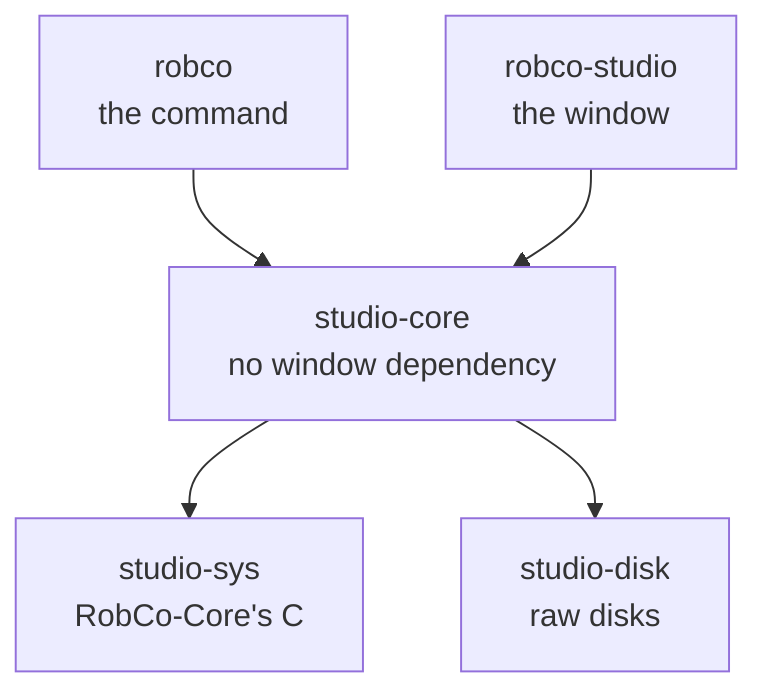
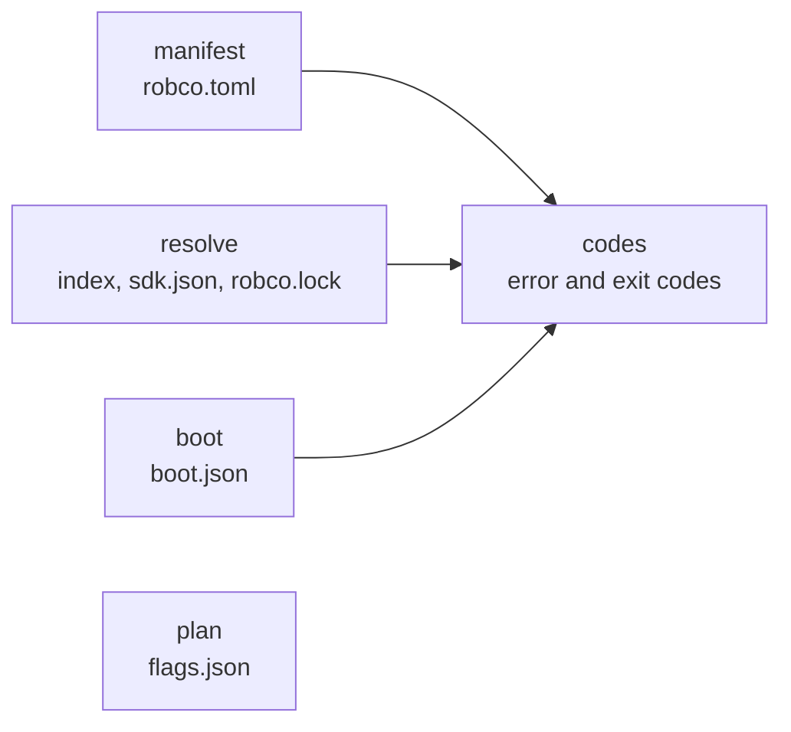

# Architecture

Studio is a core library with a command line, and a window that calls the same library. The core has no window dependency. Every feature lands in the core with a command and a test before the window shows it.

Today every crate is a shell. This page shows where code will go.

## Crates

The build arrows go one way: the two low libraries, then the core, then the two programs.

Inside `studio-core`, the build plan, the lock and the code table stand apart. Every error of `manifest`, `resolve` and `boot` names a code of `codes`.

### studio-sys

A library that compiles a fixed list of RobCo-Core's C files from the submodule at `external/robco-core` and exposes them through hand-written declarations and safe wrappers: image checks, CRC-32, INI and FAT card images through FatFs. Image sealing comes later. See [crates/studio-sys/README.md](../crates/studio-sys/README.md). It depends on no other crate of the workspace. `unsafe` is allowed here, because calling C needs it.

### studio-disk

A library that will list disks and read and write raw blocks on each system, refuse a system disk, and run as an elevated helper. It is empty today. It depends on no other crate of the workspace. `unsafe` is allowed here, because raw disk access calls system interfaces.

### studio-core

The headless product. It will hold projects, SDK install, builds, asset packing, card images, simulator sessions, the serial monitor and debug sessions. Today it holds the version, which comes from `workspace.package.version` in the root `Cargo.toml`, the reader of `robco.toml`, and the build plan, which reads `flags.json` and lists the commands of a build and the folders they write into, without running them. It also holds `resolve` and `codes`, below. It never depends on a window or toolkit crate. `unsafe` is forbidden.

#### resolve

`resolve` picks the SDK packages and tools a project builds with. It reads the SDK index and a package's `sdk.json`, picks package versions by the version and ABI rules, and reads, checks and writes `robco.lock`. It checks a lock for staleness against the target and the host. It follows [SDK_PACKAGE.md](../external/robco-core/docs/spec/SDK_PACKAGE.md) and the `robco.lock` section of [STUDIO_PROJECT.md](../external/robco-core/docs/spec/STUDIO_PROJECT.md).

It never downloads, installs or starts a process. Only the lock code touches files, in a folder the caller names. No function both resolves and writes the lock: `use_or_resolve` and `resolve_again` return a resolution and write nothing.

A caller must write the lock with `lock::write` only for a `Resolution::New`, and only after every install passed. A command that fails before then writes no lock, so a first build keeps no lock and `robco update` keeps the old one. The write goes through a temporary file renamed over the old lock, so a failure never leaves half a lock.

#### codes

`codes` holds the table of error codes and the exit code of each, from the "Exit codes" and "Error codes" sections of [STUDIO_CLI.md](../external/robco-core/docs/spec/STUDIO_CLI.md). Every error of `manifest`, `resolve` and `boot` gives its code through the `ErrorCode` trait, and `exit_code` maps a code to the number the command ends with. It reads no file and prints nothing.

### robco

The command. It will parse arguments and print JSON events, and leave all work to the core. Today it answers `robco --version` and `robco version`. `unsafe` is forbidden.

### robco-studio

The window. It will draw views and editors through a thin layer of our own over the toolkit, and hold no logic a test cannot reach through the core. Today it prints its version and opens no window. `unsafe` is forbidden.
