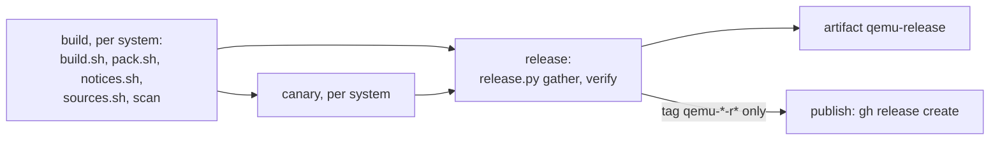

# Third-party terms

Studio downloads a compiler built by the xPack project from Arm's sources. Studio publishes its own builds of QEMU. On each system some libraries are packed beside them. This page records the terms those binaries come under, and what Studio must do to respect them.

**This is not legal advice.** Nobody who wrote this page has legal training. The page quotes what the licences and the projects' own pages say, with links, and states what seems to follow for Studio. Each point marked **Needs legal review** waits for a person with legal training. Nothing here is proven right in law.

Every source below was read on 2026-11-25. Where a source could not be reached, the page says so.

## The compiler: xPack `arm-none-eabi-gcc` 15.2.1-1.1

| Item | What the source says | Source |
|---|---|---|
| Origin | Based on Arm GNU Toolchain "release 15.2.Rel1 from 17 Dec 2025 and uses the same sources". Carries GCC 15.2.1, binutils 2.45, newlib 4.5.0, GDB 16.3. | [xPack release notes](https://xpack-dev-tools.github.io/arm-none-eabi-gcc-xpack/blog/2026/03/03/arm-none-eabi-gcc-v15-2-1-1-1-released/) |
| Download place | "The binary files are available from GitHub Releases." The notes publish a SHA-256 per archive. | Same page, and the [release tag](https://github.com/xpack-dev-tools/arm-none-eabi-gcc-xpack/releases/tag/v15.2.1-1.1) |
| xPack's own scripts | MIT, "Copyright (c) 2019-2026 Liviu Ionescu". This covers xPack's build scripts, not GCC. | [LICENSE](https://github.com/xpack-dev-tools/arm-none-eabi-gcc-xpack/blob/xpack/LICENSE) |
| Licence texts in the archive | The archive has a `distro-info/licenses` folder. Its contents were not read: no page lists them, and this page was written from web pages only. | [Install page](https://xpack-dev-tools.github.io/arm-none-eabi-gcc-xpack/docs/install/) |
| Redistribution by others | Neither the project page, the install page, the FAQ nor the release notes say anything about redistribution or mirroring. | [Project](https://github.com/xpack-dev-tools/arm-none-eabi-gcc-xpack), [FAQ](https://xpack-dev-tools.github.io/arm-none-eabi-gcc-xpack/docs/faq/) |
| Arm's terms | The Arm download page now redirects to a GitLab project that shows no licence or terms. No Arm terms for the sources were found. | [Arm downloads](https://developer.arm.com/downloads/-/arm-gnu-toolchain-downloads), [redirect target](https://gitlab.arm.com/tooling/gnu-toolchains-for-arm) |
| `libgcc` and `libatomic` | GPL version 3 or later, with "the GCC Runtime Library Exception, version 3.1". | [libgcc2.c](https://github.com/gcc-mirror/gcc/blob/master/libgcc/libgcc2.c), [libatomic_i.h](https://github.com/gcc-mirror/gcc/blob/master/libatomic/libatomic_i.h) |
| The exception | "You have permission to propagate a work of Target Code formed by combining the Runtime Library with Independent Modules, even if such propagation would otherwise violate the terms of GPLv3, provided that all Target Code was generated by Eligible Compilation Processes." A process is eligible "if it is done using GCC, alone or with other GPL-compatible software". | [GCC Runtime Library Exception 3.1](https://www.gnu.org/licenses/gcc-exception-3.1.html) |
| newlib | "a collection of software from several sources": BSD-style, MIT, Apache 2.0 with the LLVM exception, LGPL for Linux targets, and others. Some BSD parts say "Redistributions in binary form must reproduce the above copyright notice". | [COPYING.NEWLIB](https://github.com/mirror/newlib-cygwin/blob/master/COPYING.NEWLIB). The sourceware.org copy refused the fetch. |

### What follows for Studio

- **Pointing, not mirroring.** Studio may point the user to xPack's own GitHub release and download the archive from there, checked against the published SHA-256. Studio then hands out no copy of GCC, so the GPL duties of a distributor do not fall on Studio. **Needs legal review**: that downloading on the user's behalf is not distribution by Studio.
- **Mirroring.** GCC, binutils and GDB are GPL. A mirror is a distribution, so it would carry the GPL source duties for the whole archive, and the newlib notices. xPack states no terms of its own beyond MIT on its scripts. The first releases of Studio do not mirror the archive. **Owner decision** if a mirror is ever wanted, and **Needs legal review** then.
- **What a tape carries from the compiler.** Pip-OS's `sdk/pipos-app.mk` links with `-nostdlib` and `-ffreestanding`, then `crt0`, the sources, `libpip.a` and `-lgcc`. So no newlib code enters a tape. Only `libgcc` can. GCC is the compiler, so the compilation is eligible, and the exception lets the tape go out under any terms. **Needs legal review**: that a `-nostdlib` link really pulls no newlib object, and that the exception covers the tape as described.

## QEMU 10.1.2

| Item | What the source says | Source |
|---|---|---|
| Licence | "The QEMU emulator as a whole is released under the GNU General Public License, version 2." Parts carry other compatible licences, named in each file. Firmware files are "separate programs with separate licenses". | [QEMU `LICENSE`](https://gitlab.com/qemu-project/qemu/-/blob/v10.1.2/LICENSE), [QEMU docs](https://www.qemu.org/docs/master/about/license.html) |
| Notices | Section 1: "keep intact all the notices that refer to this License" and "give any other recipients of the Program a copy of this License along with the Program." | [QEMU `COPYING`](https://gitlab.com/qemu-project/qemu/-/blob/v10.1.2/COPYING), GPL version 2. gnu.org refused the fetch. |
| Source | Section 3: accompany the binary with "the complete corresponding machine-readable source code", or a written offer "valid for at least three years". | Same |
| Complete source | "all the source code for all modules it contains, plus any associated interface definition files, plus the scripts used to control compilation and installation of the executable." | Same |
| Same place | "If distribution of executable or object code is made by offering access to copy from a designated place, then offering equivalent access to copy the source code from the same place counts as distribution of the source code". | Same |
| System libraries | The source "need not include anything that is normally distributed ... with the major components ... of the operating system ... unless that component itself accompanies the executable." | Same |

### What follows for Studio

- Each QEMU release puts QEMU's exact source archive in the same release as the binaries. That is the "same place" route, and it needs no written offer. The archive alone is not enough: the release also carries Studio's build and packing scripts, since they control compilation and installation.
- A packed library "accompanies the executable", so the system-library exception does not cover it. Its source goes in the release too. A library the user installs from the system, as on Linux today, does not go out with Studio's archive. glibc stays a system library on Linux even once other libraries are packed there. **Needs legal review** of both points.
- **GPL-3.0-or-later beside GPL version 2.** Studio starts QEMU as a separate program and talks to it over TCP. It does not link it. GPL version 2 section 2 says "mere aggregation of another work not based on the Program with the Program ... does not bring the other work under the scope of this License". Studio's own licence, GPL version 3 section 5, says "Inclusion of a covered work in an aggregate does not cause this License to apply to the other parts of the aggregate." So the two seem to sit well side by side, each under its own licence. The FSF FAQ on where aggregation ends could not be read: gnu.org refused the fetch. **Needs legal review.**

## Libraries packed with QEMU

The list comes from the pack reports of [`tools/qemu/pack.sh`](../tools/qemu/pack.sh), as the [QEMU workflow](../.github/workflows/qemu.yml) builds it. What each system's archive holds today:

| System | Packager | Packed in the archive | Where | Runtime dependencies from the system |
|---|---|---|---|---|
| macOS | Homebrew | glib, pcre2, intl, pixman, libfdt | `lib/` | macOS's own libraries, zlib and iconv among them |
| Windows | MSYS2 | glib, pcre2, intl, iconv, pixman, libfdt, zlib, winpthread | `bin/`, beside the `.exe` files | Windows's own libraries |
| Linux | Ubuntu 22.04 | glib, pcre 8, pixman, libfdt, zlib | `lib/`, found through the run path `$ORIGIN/../lib` | glibc only |

The Linux archive is built on Ubuntu 22.04. There glib uses pcre 8, `libpcre.so.3`, and not pcre2, and nothing needs libatomic. A build on 24.04 would carry pcre2 and libatomic instead of pcre 8. The archive's `licenses/packed-libraries.txt` records the exact package of each file.

| Library | Licence | Binary terms, quoted | Source read |
|---|---|---|---|
| glib | LGPL 2.1 or later | Section 4: object code must "accompany it with the complete corresponding machine-readable source code". Section 6: "give prominent notice with each copy of the work that the Library is used in it" and "supply a copy of this License". | [glib `COPYING`](https://github.com/GNOME/glib/blob/main/COPYING), [LGPL 2.1 text](https://github.com/GNOME/glib/blob/main/LICENSES/LGPL-2.1-or-later.txt). gitlab.gnome.org refused the fetch. |
| pcre 8, Linux only | BSD-3-Clause | "Redistributions in binary form must reproduce the above copyright notice, this list of conditions and the following disclaimer in the documentation and/or other materials provided with the distribution." | The `copyright` file of Ubuntu's `libpcre3` 8.39 package, as packed. It is the packager's copy of the upstream `LICENCE`, and its heading still says "Release 7". The upstream 8.39 archive was not read. |
| pcre2 | BSD-3-Clause WITH PCRE2-exception | "Redistributions in binary form must reproduce the above copyright notices", the conditions and the disclaimer. | [LICENCE.md](https://github.com/PCRE2Project/pcre2/blob/master/LICENCE.md) |
| pixman | MIT | The notice "shall be included in all copies or substantial portions of the Software." | [COPYING](https://cgit.freedesktop.org/pixman/tree/COPYING) |
| libfdt | GPL or 2-clause BSD, the user's choice | "it may be used either under the terms of the GPL, or under the terms of the 2-clause BSD license". Under BSD, binaries carry the notice. | [README.license](https://github.com/dgibson/dtc/blob/main/README.license) |
| zlib | zlib licence | "This notice may not be removed or altered from any source distribution." An acknowledgment in documentation "would be appreciated but is not required." | [LICENSE](https://github.com/madler/zlib/blob/master/LICENSE) |
| intl, from gettext | LGPL 2.1 | Same duties as glib. | [intl `COPYING.LIB`](https://github.com/autotools-mirror/gettext/blob/master/gettext-runtime/intl/COPYING.LIB), a mirror. The gettext manual's licence page refused the fetch. |
| iconv | LGPL, version not stated on the page | "The `libiconv` and `libcharset` libraries and their header files are under LGPL." | [libiconv](https://www.gnu.org/software/libiconv/) |
| winpthread | MIT, plus a 3-clause BSD part | "Redistributions in binary form must reproduce the above copyright notice, this list of conditions and the following disclaimer in the documentation and/or other materials provided with the distribution." | [COPYING](https://github.com/mingw-w64/mingw-w64/blob/master/mingw-w64-libraries/winpthreads/COPYING), a mirror |
| libatomic, packed by no archive today | GPL 3 or later with the GCC Runtime Library Exception 3.1 | See the compiler table. | [libatomic_i.h](https://github.com/gcc-mirror/gcc/blob/master/libatomic/libatomic_i.h) |

## Checklist for each QEMU release

Whoever builds a release follows this list. Each archive is one host's build. Each step applies only to the libraries that archive really carries: see the table above.

1. Inside each archive, a `licenses/` folder with:
   - QEMU's `COPYING` and `LICENSE`, copied from the source tree it was built from.
   - For each library packed in that archive: its licence file, copied from the exact source version packed, named after the library, such as `licenses/glib-COPYING`. The archive holds the full text of every licence that applies to each library, not only a file that names it. On Linux the packager's `copyright` file, such as `licenses/glib-copyright`, is the notice. It often names a licence and points to its text under `/usr/share/common-licenses/`, so the packer copies each text it points to, once, as `licenses/text-<name>`, such as `licenses/text-LGPL-2.1`. On macOS and Windows, a text the Homebrew keg or the MSYS2 package does not install is taken from the library's source archive of the same version. glib and intl carry the LGPL 2.1 text. libatomic carries GPL version 3 and the runtime exception text.
2. Inside each archive, a `NOTICE` file that says, in plain words: this is QEMU 10.1.2 under GPL version 2; it uses glib and the other packed libraries, listed by name, version and licence; and where the sources are, by release URL.
3. In the same release, beside the binaries:
   - QEMU's official `qemu-10.1.2.tar.xz`, unchanged, with its SHA-256.
   - Studio's build and packing scripts at the tagged commit, with the `configure` line used.
   - For each packed library, four things: the upstream source the binary was built from, the packager's patches, the packager's build recipe, and the record of which package version was packed. Homebrew or MSYS2 built these binaries, not Studio. The LGPL 2.1, section 0, counts as a library's source "the scripts used to control compilation and installation of the library", and section 4 asks for "the complete corresponding machine-readable source code" with object code. The licence text seems to make the packager's recipe and patches part of that source. **Needs legal review.**
   - This duty applies today to glib, intl and iconv, under the LGPL. libfdt is under GPL or BSD, and under BSD it carries only a notice. pcre2, pixman, zlib and winpthread carry only a notice duty. libatomic, through GCC's source, joins the first group once Linux packs it. Ship the same four things for every packed library anyway, since one rule is simpler to check than sorting nine.
   - Studio's own patches, if any. Today there is none. `dylibbundler` and `patchelf` change the binaries, not the sources.
4. The release build records, at the moment it packs, what it packed, and puts that record in the archive's `licenses/` folder and in the release:
   - **Homebrew.** Each installed formula has an `INSTALL_RECEIPT.json` in its keg. Homebrew's [`tab.rb`](https://github.com/Homebrew/brew/blob/main/Library/Homebrew/tab.rb) writes a `source` entry with `tap_git_head`, the homebrew-core commit at install. The full receipt also names folders of the machine that installed it, such as Homebrew's cache under the home folder, so the package never holds it. [`brew_receipt.py`](../tools/qemu/brew_receipt.py) writes `licenses/<library>-homebrew-receipt.json` with a fixed key order and only these fields: `formula` and `keg_version`, the keg packed; `tap` and `tap_git_head`, where the formula file lives; `stable_version`, the upstream version; `poured_from_bottle`, whether Homebrew's bottle built the library; and `homebrew_version`. `notices.sh --check` reads that file in the package and fails unless its fields are exactly these, it holds no absolute path, and its formula, keg version and `tap_git_head` are those of the library's record line. The library sources carry the same reduced receipt and the `brew info --json=v2` output. The recipe is the formula file in [homebrew-core](https://github.com/Homebrew/homebrew-core) at that commit, with any patches it names. **Not confirmed**: that `tap_git_head` is the commit that built the bottle rather than the one the user's tap was at on install. Homebrew's docs pages do not describe the receipt.
   - **MSYS2.** `pacman -Qi` gives each installed package's exact version. The recipe is the `PKGBUILD` and its patch files in [MINGW-packages](https://github.com/msys2/MINGW-packages). MSYS2 also publishes a source package per version, such as `mingw-w64-<name>-<version>.src.tar.zst`, in [repo.msys2.org/mingw/sources](https://repo.msys2.org/mingw/sources/). The build saves the `pacman -Qi` output and ships the matching source package. **Not confirmed**: that each source package holds the `PKGBUILD`, its patches and the upstream archive. The directory lists them, but none was opened. Finding the MINGW-packages commit for a given version would otherwise mean searching its history.
   - **Ubuntu.** `dpkg -S` names the package that owns each packed file, and `dpkg-query -W -f '${Version} ${source:Package} ${source:Version}'` gives its exact version and its source package. The recipe and the patches are the source package itself: its `.dsc`, the upstream archive and the `debian` archive, which hold the rules file and the patches. A person fetches them with `apt-get source <source>=<version>` on a system with `deb-src` lines, or from the package's page at `https://launchpad.net/ubuntu/+source/<source>/<version>`. **Not confirmed**: that every packed version is still on Launchpad and in the archive. Ubuntu replaces security updates in place, so an older version may only stay on Launchpad. Neither route was tried.
5. Keep each release's sources up for as long as its binaries are up. GPL version 2's three-year term applies to the written offer, which this route does not use.
6. Before publishing, check that each archive has its `licenses/` folder and `NOTICE`, and that for each library file packed, on Linux and macOS each file in `lib/`, on Windows each `.dll` in `bin/`, `licenses/packed-libraries.txt` names its licences and `licenses/` holds the full text of each. `tools/qemu/notices.sh --check` does this. It takes the list of libraries from the files in the package and the licences of each from its own table, and checks the record against both. A library it does not know fails the check.

## How a QEMU release is made

The [QEMU workflow](../.github/workflows/qemu.yml) builds, packs and tests QEMU on each system, then gathers the release. It publishes only for a pushed tag of the form `qemu-<QEMU version>-r<n>`, such as `qemu-10.1.2-r1`. The version must be the one packed, or the release job fails. `r<n>` counts rebuilds of the same QEMU version. A pull request that touches the workflow or `tools/qemu/`, and a manual start, run the same jobs as a dry run: the release files go up as the workflow artifact `qemu-release`, and nothing is published. Only the `publish` job may write to the repository.

What the steps do:

- [`sources.sh`](../tools/qemu/sources.sh) runs in the job that packs, right after the packing. It fetches the sources of every packed library at the exact version packed, and fails if one cannot be fetched or if the installed package is no longer that version. On Ubuntu it takes the source package with `apt-get source --download-only`: the `.dsc`, the upstream archive and the `debian` archive with the rules and patches. On macOS Homebrew installs from its API and keeps no copy of homebrew-core, so `brew cat` cannot read a formula there, and it turns on developer mode. [`brew_sources.py`](../tools/qemu/brew_sources.py) works from `brew info --json=v2` instead. It first checks that the formula's full version, revision included, is the packed keg's: a formula that moved fails the release. It fetches the formula file from homebrew-core at the commit `tap_git_head` and the path `ruby_source_path` that brew info names, and checks it against `ruby_source_checksum`. The fetched file must state the same source URL, checksum and revision. It then fetches the stable source archive and each patch, a URL or a file in the tap at the same commit, each checked against the SHA-256 brew info states. It keeps those, the install receipt and the brew info output, and runs no other brew command. On an install from the API the receipt's own `tap_git_head` is empty. On Windows it fetches MSYS2's source package, named after the package base in pacman's database, and checks that it holds a `PKGBUILD`. Fetching later is not safe: Ubuntu's archive keeps only the newest version of each pocket, and the other packagers may prune.
- `release.py scan` fails when a packed file holds the build folder's path, the home folder, the workspace, the runner's temporary folder, the host name, or the build account's name in a home path or before an @. It reads these values from the environment and takes the host and user names from Python, the user name from the password database on Linux and macOS and from `os.getlogin` on Windows, so Git Bash on Windows cannot rewrite a path on the way. A path with a drive letter is searched as `C:\x`, `C:/x`, `C:\\x` as a C or JSON string holds it, and `/c/x`, which `/cygdrive/c/x` contains, without regard to case. Any other path is searched with either slash, and without regard to case on macOS. Each spelling and the host name are searched in UTF-8 and in UTF-16 little endian. The user name is searched as `/home/<name>`, `/Users/<name>` with either slash, and `<name>@`, never alone: on Linux and macOS the account is `runner`, an ordinary word. A user name shorter than 4 characters is refused. The scan is first shown to fail on a copy that holds the home folder in each spelling, each in its own file, one in UTF-16, and it must name each. The same copy holds each form of the user name this system can have, each in its own file, which it must name, and the bare name in a file it must not name. Each hit prints its byte offset and the printable string around it. `build.sh` compiles with `-ffile-prefix-map` for each spelling of its build folder, from [`prefix-map.sh`](../tools/qemu/prefix-map.sh), so `__FILE__` in assertions names no folder of the machine. The configure line the release publishes names that folder `<work>`. **Not confirmed** until a run: that no other string of the build, such as a path QEMU derives from its build folder, stays in the programs.
- `release.py gather` writes the release. `release.py verify` checks that the list names exactly the files, with their sizes and SHA-256, that `SHA256SUMS` agrees, and that each archive holds `bin/` with both programs, `NOTICE` and `licenses/` under its root. Both check the library sources against `SOURCES.txt`: `gather` before it writes each library-sources archive, `verify` inside each archive. A file whose SHA-256 differs, a file not listed and a listed file that is missing all fail. Both also read the ELF, Mach-O or PE header of each file in `bin/` and `lib/`: `gather` in each package before it writes anything, `verify` inside each archive. Each must be a program of the machine its archive name states, x86-64 for `linux-x64` and `windows-x64`, arm64 for `macos-arm64`. A program of another machine, or a file whose header cannot be read, fails with its name. The macOS package is built on the `macos-15` runner, which is Apple silicon.

The files of a release, for QEMU 10.1.2:

| File | What it holds |
|---|---|
| `qemu-10.1.2-linux-x64.tar.gz`, `qemu-10.1.2-macos-arm64.tar.gz`, `qemu-10.1.2-windows-x64.zip` | One package each, under the folder `qemu-10.1.2-<host>/`. That folder is the `root` of the index's archive object, and it holds `bin/`, `NOTICE` and `licenses/`. |
| `qemu-10.1.2-<host>-notices.tar.gz` | The `NOTICE` and `licenses/` of that package, to read without unpacking it |
| `qemu-10.1.2-<host>-library-sources.tar` | The sources of the libraries packed for that host, with `SOURCES.txt`, the list of each file and its SHA-256 |
| `qemu-10.1.2.tar.xz` | QEMU's source archive, unchanged. The release job checks its SHA-256 against the one each `NOTICE` names. |
| `qemu-10.1.2-recipe.tar.gz` | `tools/qemu/`, the workflow, this page, and the `configure` line of each host |
| `qemu-10.1.2-files.json` | Every file above with its `url`, `size` and `sha256`, and under `archives` one object per host in the form of the index: `url`, `size`, `sha256`, `root` |
| `qemu-10.1.2-SHA256SUMS` | The same hashes and the list's, for `sha256sum -c` |

The archives are written with fixed times and owners, so the same packages give the same bytes. On a tag each `url` is the release's download address. In a dry run it is the file name, as in a local index.

What only a real run proves: that the hosted runners' packagers still serve each source, that the scan passes on the real binaries, and that `gh release create` publishes the files. Nothing has been published yet. The first release waits for the owner's agreement.

## What the SDK manager shows before a download

No licence read here requires Studio to show anything before the user downloads xPack's archive from xPack. Studio should still say plainly what is downloaded, from where, its size, and that it is GNU software under the GPL with other licences inside, with a link to the release page. **Owner decision**: whether to ask the user to agree, or only to inform.

For Studio's own QEMU archive, the `NOTICE` and `licenses/` folder go with the copy, which is what GPL version 2 and the LGPL ask. The same short line, with a link to the release and its sources, is enough to show.

## The window's toolkit and fonts

`robco-studio` links `eframe` and `egui` 0.37.0, MIT OR Apache-2.0, `resvg` 0.45, Apache-2.0 OR MIT, and on macOS `muda` 0.17, Apache-2.0 OR MIT. Every crate they bring is under a licence in `deny.toml`, except two that build on Windows only: `clipboard-win` and `error-code`, both BSL-1.0, which the clipboard feature needs. BSL-1.0 is not on the allow list. **Owner decision**: allow BSL-1.0, or build the window without the system clipboard on Windows.

The window bundles two fonts. Each comes from its official release, checked against the SHA-256 GitHub publishes for the release file.

| Font | Release | Licence | Files in the repository |
|---|---|---|---|
| Spleen 8x16 | [2.3.0](https://github.com/fcambus/spleen/releases/tag/2.3.0), `spleen-2.3.0.tar.gz` | BSD-2-Clause | `spleen-8x16.bdf`, `LICENSE-spleen.txt` |
| IBM Plex Mono, Regular, Bold and Italic | [plex-mono 2.5.0](https://github.com/IBM/plex/releases/tag/%40ibm%2Fplex-mono%402.5.0), `ibm-plex-mono.zip` | SIL Open Font License 1.1 | `IBMPlexMono-Regular.ttf`, `IBMPlexMono-Bold.ttf`, `IBMPlexMono-Italic.ttf`, `LICENSE-plex-mono.txt` |

They live in `crates/robco-studio/assets/fonts/`. `REUSE.toml` names their licences. The OFL lets a font ship inside a program as long as the font is not sold alone and its licence goes with it. "Plex" is a Reserved Font Name: the files are not changed, so the name stays.

## Open points

- **Needs legal review**: that downloading xPack's archive for the user is not distribution by Studio.
- **Needs legal review**: that a `-nostdlib` tape carries nothing from newlib, and that the runtime exception frees what `libgcc` adds.
- **Needs legal review**: that starting QEMU over TCP keeps Studio and QEMU separate works, given the FSF FAQ could not be read.
- **Needs legal review**: that the "same place" route, with the build scripts, meets GPL version 2 section 3 for QEMU, and LGPL 2.1 section 4 for glib, intl and iconv.
- **Not read**: the contents of the xPack archive's `distro-info/licenses`. Reading them needs the archive itself, which was not downloaded for this page. So it stays unknown which licence texts xPack ships, and whether they add any duty.
- **Not found**: any terms Arm sets on its toolchain sources. The Arm page redirects to a GitLab project that shows none.
- **Not read**: the version of the LGPL on libiconv's own source. The page names the LGPL without a version.
- **Chosen for the first release**: keep packing the libraries that Ubuntu, Homebrew and MSYS2 built, and ship each packager's source, patches and recipe, as fetched by `sources.sh`. Building them in Studio's own script from pinned sources stays open for later.
- **Needs legal review**: that the packager's recipe and patches are part of a packed LGPL library's corresponding source, as the LGPL 2.1 text seems to say.
- **Owner decision**: mirror xPack's archive or not. The first releases do not.
- **Owner decision**: what the SDK manager asks of the user before a download: agree, or only inform.
