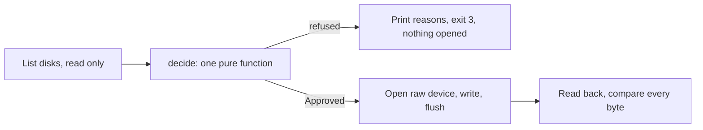

# Spike K6: the card writer

## The question

Can a card writer written in Rust write an image to a disk and read it back, on Ubuntu, macOS and Windows? Does it refuse a system disk?

Short answer: yes on all three, on virtual disks in CI. It refused the runner's own system disk on all three without opening it for writing. No real card reader was used.

## The method

The code is in [`spikes/k6`](../../spikes/k6). It is one crate, `card-writer`, with a command named `k6`.

- **The list.** Each system has a parser that turns the system's own output into one shape: path, size, removable, bus, holds the running system, mounted system volumes, all mounted volumes, a label and the block size.
- **The rules.** `rules::decide` is a pure function over that list. It returns an `Approved` value or a list of reasons. `Approved` has private fields and only `decide` builds it. `write::write_and_verify` takes an `Approved` and nothing else, so the write path cannot open a disk the rules did not pass. The command lists the disks again right before it decides.
- **The write.** It opens the raw device, writes the image in 1 MiB chunks padded with zeros to 4096 bytes, flushes, closes, opens the device again for reading and compares every byte.
- **Tests.** 13 tests run the rules on recorded lists for the three systems in [`tests/fixtures`](../../spikes/k6/card-writer/tests/fixtures). The lists are written by hand in the exact shape of each tool's output. None comes from a real machine of a person.
- **CI.** [`spike-k6.yml`](../../.github/workflows/spike-k6.yml) runs format, Clippy and the tests on the three systems. Then one job per system creates a 64 MiB virtual disk, writes a 60 MiB pseudo-random image to it, reads it back, checks that a different image is reported as different, then detaches and deletes the disk. Before that, each job asks the writer to write to the runner's own system disk and checks the refusal.

### What each lister reads

| System | Source | Field and how reliable it is |
|---|---|---|
| Linux | `lsblk --json --bytes --paths` with NAME, TYPE, SIZE, RM, HOTPLUG, TRAN, MOUNTPOINTS, VENDOR, MODEL, LOG-SEC | Mounts are reliable and walk through LUKS, LVM and RAID children. TRAN is empty on many virtual machines and on some built-in readers. RM is 0 on many built-in SD slots. Removable is RM or HOTPLUG. Older lsblk writes strings and `mountpoint`: both are read. |
| macOS | `diskutil list -plist`, `diskutil info -plist` for each whole disk and for `/`, turned into JSON by `plutil` | `BusProtocol` is the best field: a disk image says Removable and not Internal, just like a card, so only the bus tells them apart. APFS containers are synthesized disks: their mounts are carried to the physical disk through `APFSPhysicalStores`. `BusProtocol` was empty on the CI runner. |
| Windows | PowerShell `Get-Disk`, `Get-Partition` and `Win32_DiskDrive`, one JSON object | `IsBoot`, `IsSystem` and the partition holding `%SystemDrive%` are reliable. `BusType` is a string in PowerShell; the raw number comes from `CimInstanceProperties`. Both must agree. Removable comes from `Win32_DiskDrive.MediaType`: "Removable Media" or not. |

### The rules

A write is refused when any of these hold. "Could not tell" is a refusal every time.

- The list is incomplete: a tool failed, its output did not parse, or one disk's details were missing.
- No disk was found to hold the running system.
- The path has odd characters, is not a whole disk in the list, or matches two entries.
- The disk holds the running system, or the lister could not tell.
- It has a mounted system volume: `/`, `/boot`, swap, `/System/Volumes/*`, `C:`, the EFI partition.
- It is a synthesized disk such as an APFS container.
- Its bus is fixed (SATA, NVMe, SAS, PCIe, Apple Fabric) or unknown.
- It is on USB or SD and not removable, or removable is unknown.
- It is a virtual disk and the CI switch `--allow-virtual` is off.
- Its size is unknown, above the cap (64 GiB by default, `--max-size-mib` to raise it), or smaller than the image.
- Any volume on it is mounted. The helper unmounts, lists again and decides again.

The hostile recorded lists cover: root three levels down under LUKS and LVM, a system booted from a USB stick on Linux and macOS, Windows To Go, root not found, a list with one `diskutil info` missing, a `DeviceNode` that names another disk, a duplicate entry, a bus number and bus name that disagree, a missing `IsBoot`, a missing size, a reader behind Thunderbolt, a partition path, a raw `rdisk` path, a path with a shell command in it, PowerShell writing a single object instead of an array, and broken or empty JSON.

## The result for each system

All CI results come from [run 45652209400](https://github.com/RobCo-Industries/RobCo-Studio/actions/runs/45652209400) on GitHub-hosted runners: `ubuntu-latest`, `macos-latest` on arm64 and `windows-latest`. All three are virtual machines.

| | Linux, `ubuntu-latest` | macOS, `macos-latest` | Windows, `windows-latest` |
|---|---|---|---|
| Lists disks | Yes, list complete | Yes, list complete | Yes, list complete |
| Finds the system disk | Yes, `/dev/sda` | Yes, the APFS container and the physical disk under it | Yes, `PhysicalDrive0` |
| Refuses the system disk | Yes, exit 3, 5 reasons | Yes for both disks, exit 3 | Yes, exit 3, 5 reasons |
| Proof it did not open it | `strace`: no open of `/dev/sda` with write flags, and the writer never reached its open | The writer never reached its open | The writer never reached its open |
| Refuses the virtual disk without the CI switch | Yes | Yes | Yes |
| Refuses a mounted disk | Yes, a FAT volume mounted on the loop device | Not run | Not run |
| Virtual disk | Loop device on a 64 MiB file | `hdiutil attach -nomount` of a 64 MiB raw image | 64 MiB fixed VHD made and attached with `diskpart` |
| Write 60 MiB, then read back | 47 ms, 1227 ms, all bytes equal | 87 ms, 845 ms, all bytes equal | 225 ms, 871 ms, all bytes equal |
| Second check outside the writer | `cmp` against the device: equal | `cmp` against `/dev/rdiskN`: equal | Not run |
| A different image is reported different | Yes, exit 4 | Yes, exit 4 | Yes, exit 4 |
| Privilege used | `sudo` | `sudo` | The runner's administrator account |

The first run, [45651969866](https://github.com/RobCo-Industries/RobCo-Studio/actions/runs/45651969866), found three faults that the second run fixed:

- On macOS, `File::sync_all` is `F_FULLFSYNC`, and a raw disk node rejects it with ENOTTY. The writer now goes on without it on macOS. `rdisk` writes are not buffered by the system, but the drive's own cache is only flushed by the `DKIOCSYNCHRONIZECACHE` ioctl, which the spike does not call.
- On Windows, the PowerShell script failed on `[int]$_.BusType` because `BusType` is a string there. Because the list was incomplete, every disk was refused. That is the rule working as meant.
- The negative test passed by accident: two seeds gave the same image. Fixed.

On this Mac, read only: `k6 list` ran `diskutil list` and `diskutil info` and gave a complete list of 16 disks. The internal disk `/dev/disk0` and the system container `/dev/disk3` were refused as holding the running system. The other APFS containers on `disk0` were refused for their mounted system volumes. The simulator disk images were listed with bus "Disk Image" and refused as virtual and mounted. No disk was opened for writing. Names of volumes and the machine are left out here.

### What each system needs for the write

| | Linux | macOS | Windows |
|---|---|---|---|
| Device | `/dev/sdX`, `/dev/mmcblkN` | `/dev/rdiskN`, the raw node, from `/dev/diskN` | `\\.\PhysicalDriveN` |
| Before writing | Unmount every partition. The writer opens with `O_EXCL`, which fails while anything is mounted. | `diskutil unmountDisk`. Not tested: the CI image was never mounted. | Lock and dismount each volume, or take the disk offline. Not tested: the CI VHD had no volume. |
| Block size | Writes padded to 4096. Read-back uses `O_DIRECT` with a 4096-aligned buffer, so it reads the device and not the page cache. | Every read and write on `rdisk` must be a whole number of blocks. 4096 covers 512 and 4096. | Same rule on `PhysicalDrive`. |
| Flush | `fsync` | `F_FULLFSYNC` fails on `rdisk`; see above | `FlushFileBuffers` through `sync_all` |
| Privilege | root, or the `disk` group | root. A desktop app gets a descriptor from `authopen` after the admin prompt. | Administrator |

## What it means for Studio

- The pure rules work as one function with recorded lists as tests. `studio-disk` can take the shape as it is. The rules must live in the helper too, as the plan says, because the helper repeats every check.
- Bus is the field that matters most. "Removable" alone accepts a macOS disk image, and on Linux it refuses most built-in SD slots.
- On all three runners the system disk's bus was unknown or not a card bus. A real laptop gives clearer data, but the rules must never lean on the bus alone to spot the system disk. They do not: holding `/`, `C:` or a system volume is checked first and on its own.
- A built-in SD slot on Linux reports RM=0 and is refused today. Studio either accepts `mmc` with RM=0, or says to use a USB reader. This is an open choice.

### The elevated helper

The spike did not build it. What it learned:

- **Linux.** `pkexec` runs a helper as root after a polkit prompt. The helper needs `lsblk` on its own PATH and must not trust the caller's environment.
- **macOS.** `authopen` asks for the admin password and hands back an open file descriptor for `/dev/rdiskN`. Then the main program writes without being root, but the rules must run before the descriptor is asked for, and the unmount needs DiskArbitration or `diskutil`. The other choice is a helper that runs as root through `SMAppService`, which needs signing.
- **Windows.** A helper started with the `runas` verb shows the UAC prompt. The whole write runs inside it.

A helper interface that fits the three:

- Input: the disk path, the size in bytes and the label the person confirmed, the image path, the size cap, and a SHA-256 of the image. Nothing else.
- The helper lists the disks itself, runs `decide`, and checks that size and label still match what the person saw. If one differs, it refuses.
- It unmounts, writes, flushes and reads back, and reports progress and a final result as JSON lines on standard output: `refused` with reasons, `progress` with bytes, `done` with the read-back result.
- It never takes a list from the caller, never runs a shell, and exits after one disk.

## What stays unknown

- **No real card reader.** A virtual disk does not prove: how a real USB reader or SD slot reports its bus and removable flag on each system, the speed of a card, a reader that hides a missing card behind a 0-byte disk, a card that disconnects halfway, a card that lies about its size, the drive's own write cache, and the system's automount racing the writer after a new partition table appears.
- **Mounted volumes on macOS and Windows.** Unmounting and the Windows volume lock were not tested.
- **A real image.** The test image is random bytes with no partition table, so no system tried to mount it after the write.
- **The macOS cache flush.** `DKIOCSYNCHRONIZECACHE` was not called.
- **Path reuse.** The disk number can change between the list and the open if a person unplugs one reader and plugs another. The helper's size and label check narrows this. It does not close it.
- **Windows second check.** No tool outside the writer compared the VHD's bytes.

## Dependencies

| Crate | Why | Licence | GPL-3.0-or-later |
|---|---|---|---|
| `serde_json` | Parse the output of the three listers | MIT OR Apache-2.0 | Yes |
| `libc`, Linux only | `O_EXCL` and `O_DIRECT` | MIT OR Apache-2.0 | Yes |

Their own dependencies are `serde`, `serde_core`, `serde_derive`, `itoa`, `memchr`, `zmij`, `proc-macro2`, `quote`, `syn` and `unicode-ident`, all under MIT, Apache-2.0, Unlicense or Unicode-3.0, all compatible. No `unsafe` code: the aligned buffer uses `align_offset`.
